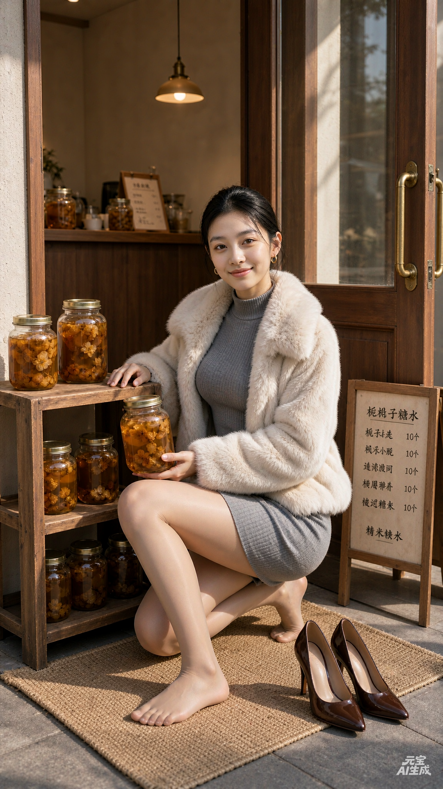

## 终稿提示词

```text
第3张 · 他（撑地）·视点高度 0.62 米、隔 0.8 米看她半跪在矮木架前够最下层那只糖渍栀子玻璃罐

9:16 满幅 1080×1920，四条边即裁切边，人物与道具铺满整幅。全画只一位成年人物。这一张是低机位半跪近景：她单膝跪在门边矮木架前、一膝立起一膝点地、脊线朝木架前折下去，画幅上沿压在玻璃门黄铜门把下沿、下缘在她脚尖前方再留两指脚垫绒边、脱下的那双鞋的鞋尖从画右下角斜进画内八厘米，矮木架三层格子与一排糖渍栀子玻璃罐占满画左、最下层那只琥珀色玻璃罐正被她托到画面横向中点，门口蜜色斜光从画右上斜切下来、一路划过她的肩、膝弯、脚背到画底脚尖外侧收住；画底收两只完整的脚与素麻脚垫，那双深栗棕漆皮尖头细高跟已经脱下、鞋尖朝矮木架腿左右并拢搁在画右下角她点地那侧膝盖后方一掌的素麻脚垫边写明已经脱下，玻璃门下沿、门侧木框手写菜单牌、门里长木柜台一角与暖黄小吊灯在画内各自占好位置，画外收边干净。

三槽分工：衣由槽 1 干净衣装层承担、脸由槽 2 人脸底图承担、姿势由槽 3 线稿承担；线稿只管躯干重心、脊线肩髋与两腿骨架。

初冬晴冷黄昏五点二十，老街转角新开的栀子糖水铺「栀半」，卖栀子冻、桂花酒酿小圆子、现熬栀子糖水与糖渍栀子玻璃罐。这一眼凑近的是门边那只矮木架：三层木格里一排糖渍栀子玻璃罐、罐里琥珀色糖渍与几片栀子、素麻门口脚垫、玻璃门与黄铜门把、门侧木框手写菜单牌、门里长木柜台的一角与暖黄小吊灯。她半跪在矮木架前够最下层那只糖渍栀子玻璃罐、一手撑住木架边、一手托住罐底。

初冬晴冷黄昏五点二十，天还剩一层青亮，日头西斜从朝西的玻璃门斜切进来，蜜色斜光斜切过矮木架三层木格与玻璃罐的弧面、在琥珀色糖渍里折出一小片亮，屋里暖黄小吊灯已经亮、长木柜台与黄铜勺反出一层暖木色，木格窗把门外青亮收成一条细边；这道蜜色斜光与吊灯暖黄顺着她单膝跪起的小腿在袜面上接成一道软界线、泛出一道细而柔的浅亮，四张同一片光、同一色号，这一片光的折光顺着腿线落到袜面与脚背上，光只改折光落点与明暗，浅栀灰这一色号从门口斜光段到柜台暖木段浓淡如一。

雾灰细罗纹高领长袖紧身针织迷你连衣裙，高领贴颈、长袖收到腕骨、裙身顺着腰肋收出细密竖罗纹、裙摆齐齐落在大腿中段；一件米白长绒短外套敞披在肩外，绒尖在领口与袖笼外圈蓬起一层。这套配这一站：初冬黄昏从青石板巷面拐进糖水铺，推门、侧坐高凳、半跪够矮架、前倾递小碟都利落，半跪时裙摆顺着大腿折出一道软褶，米白长绒在暖黄吊灯里泛出柔绒光，雾灰罗纹在蜜色斜光里压成一层哑光，裙摆落在大腿中段把整条腿线让给那一层袜面与门口那片斜光。本轮那双深栗棕漆皮尖头细高跟鞋：尖头收口、9 厘米细高跟、一道一字细踝带配一枚黄铜小圆扣、深栗棕绝对色号 #4A2C22 的漆皮硬亮；尖头收口接高领与裙摆齐切的直线同为收口语言，9 厘米细跟把大腿中段到脚背那条线拉成一道斜提的弧，黄铜小圆扣接玻璃门黄铜门把与柜台上那把铜勺、全身金件只此三处互答，深栗棕接熬糖木色与玻璃罐里琥珀色栀子糖渍，漆皮硬亮与雾灰罗纹的哑光一硬一软各留一道自己的反光，鞋已脱下，与这一身同色放在素麻脚垫边接住进店那一步。

发色冷调黑茶棕、发长过肩胛骨下缘八厘米发尾齐平收钝角、头顶偏她右侧三七分缝由额角向后梳出一道斜白线、发身大弧度低速卷只发尾十五厘米走一个向内 C 形弯中段顺直、薄法式八字刘海前短后长最长一缕落颧骨上方一指、耳侧左右各一缕细碎发长到下颌角下两厘米、不束发无发饰耳后露出耳廓与一枚小金耳钉、发量偏厚颅顶蓬起约两厘米；俯身半跪、头位朝矮木架压低约二十度，全部发丝朝前下方垂落、主体散在朝木架那一侧的左肩与锁骨前并顺着前折的脊线滑下去一小把，右耳后一缕被俯身带起、离肩一指悬着再落回外套绒尖上，三七分缝随头位转到他这一眼能看见的斜侧、八字刘海压出一道比站立时更深的弧、弧尖点在左眉尾上方一指，耳侧两缕碎发一缕贴颌角、一缕垂到矮木架第二层格沿前两厘米随托罐的小臂晃住不动。

杏仁甲、长度超出指尖三毫米甲尖圆收不尖、绝对色号 #6E3B2C 栀子糖壳棕、光疗硬式封层高亮镜面档甲面中段一道纵向细光带、无钻无贴片无手绘只每枚甲尖一道零点五毫米 #C9973F 细金法式边与黄铜小圆扣同色，十指同一款四张同一款；托罐的右手因罐身弧面迎光，食指、中指、无名指三枚甲面的镜面细光带正对画右上蜜色斜光连成一道短亮弧、食指那道最宽，甲缘细亮落在食指指尖压住罐身凸纹的那一线；撑木格的左手四指并压格沿、只有拇指与中指两枚甲面侧收到木格反上来的暖木光、甲缘细亮落在中指指尖抠住格沿前棱的那一点，两只手各一处。

15D、绝对色名浅栀灰 #C9BCAE、包芯锦纶氨纶无缝一体织、微光档哑光打底覆一层极细丝光不到油亮、半透膝上透肤色一层暖小腿以下织密略收、织物折光沿腿线走一道连续细银灰亮线受力处膝弯踝骨前脚背弓起拉开浅一档细褶影非受力面平顺如薄釉、贴肤如第二层皮腿根膝头踝骨三处轮廓清晰不空不鼓与肤色是透出而非盖上、四张同一色号不随本张光位改色；单膝跪起那条小腿前缘的织物折光被蜜色斜光拉成一道细长直亮线、从胫骨中段一贯到脚踝边界，点地那侧膝弯因承重压出两三道半月形细褶影、褶沟里只压深仍透浅栀灰本色，脚背被脚掌踩实脚垫绒面撑出一片宽约两指的宽幅微光，从脚背那片微光往下经脚尖到画底脚尖外侧是一整片把门口蜜色斜光透出来的连续折光，近光一侧画右亮半档、靠木架一侧画左暗半档，深浅只在浅栀灰 #C9BCAE 这一个色号里走、色相与色号不变、整层与另外三张不差过一档，五趾在袜面里各自分明、趾缝平顺、脚尖与脚背同一片平顺袜面。

按 `[女主设定]` 24h 穿一层连裤丝袜从腿根连包到脚趾，脚趾由同色透明袜面完整包住、五趾在透明袜面里各自分明，袜面从小腿到脚背到脚尖连成平顺同一片，脚踝与小腿前缘有一道织物折光把袜面与腿肤色分出一层可辨边界；这一层四张同一色号，只随姿势与光位落折光与褶影。

本张鞋的判断（状态：不穿鞋露脚）：她半跪在门边矮木架前够最下层那只糖渍栀子玻璃罐，因为这一眼膝盖点着素麻脚垫、脚掌要稳稳踩住脚垫绒面才够得着罐底，换早在第 1 张进店那一步已经完成；那双深栗棕漆皮尖头细高跟已经脱下、鞋尖朝矮木架腿左右并拢搁在画右下角她点地那侧膝盖后方一掌的素麻脚垫边写明已经脱下；画底只收她两只完整的脚踩在脚垫绒面上、十趾由同色透明袜面完整包住、袜面从脚背到脚尖连成平顺同一片、这一片落进本张那道蜜色斜光里，五趾在袜面里各自分明，脚踝与小腿前缘一道织物折光把袜面与腿肤色分出一层可辨边界。

全画共两条手臂、两只手、两条腿，两条手臂各自从肩经肘腕连到指尖、各只做一个动作；两只脚各自从腿根连续到脚趾，在画内完整收口。
右手从肩经肘腕到指尖托住最下层那只琥珀色糖渍栀子玻璃罐的罐底、五根手指分开兜稳玻璃弧面、食指指腹贴着罐身一道凸纹，托稳之后手腕往外旋五度、罐身随之转一点、琥珀糖渍里那片栀子把蜜色斜光漏一道细亮条斜扫过点地膝的膝弯褶影和脚背那片宽幅微光；左手从肩经肘腕到指尖撑在矮木架第二层格边、五根指头并着按住木格前沿、腕骨压出一小道棱；米白长绒短外套敞披在两肩外、绒尖随前折的脊线朝木架那一侧垂下一圈，眼尾先落在罐里栀子上、瞳仁已经偏过来半寸接住他撑地的这一眼，一膝立起一膝点地、两只脚掌平落在素麻脚垫绒面上、脚尖朝矮木架那一侧并拢。

画面里只落她自己这一位人物，两条手臂各自在画内完整收口。
这一眼的取景落点落在袜面、脚背、腿线那一片光与折光上，她嘴角那点先替你挑好了的弯收住一半、眼尾从罐沿上压着他撑地的这一眼多停一拍，脸年轻柔和、神态松弛。
```

## 一句点评

半跪托最下层糖渍栀子玻璃罐
