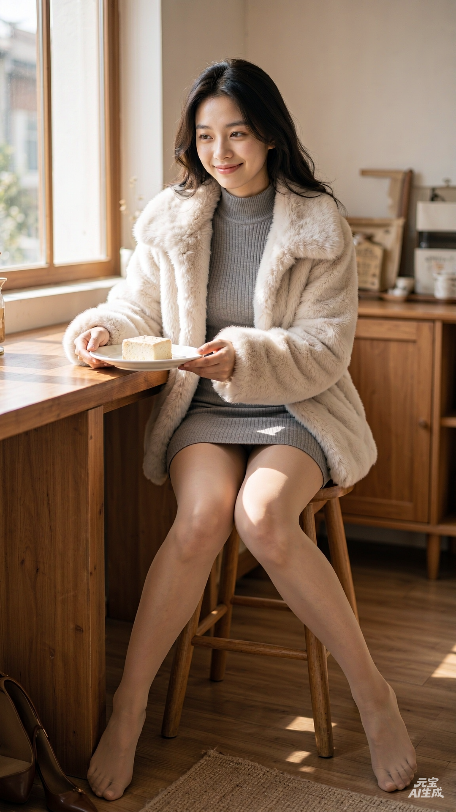

## 终稿提示词

```text
第4张 · 他（坐）·视点高度 1.02 米、隔 0.45 米看她在柜台高凳上开膝前倾把白瓷试吃小碟递到两人正中间

9:16 满幅 1080×1920，四条边即裁切边，人物与道具铺满整幅。全画只一位成年人物。这一张是凑近的低机位特写：她坐在柜台前高脚木凳上、两膝外开、脊线朝前送、头位压低约十五度，画幅下沿压在两只脚尖前方一指木地板、把脚尖那一整片透光浅弧连同木地板上一道两厘米长的蜜色淡影一起收进画底、上沿落在暖黄小吊灯灯罩下缘再留一指空气、低头后颅顶那道冷调黑茶棕弧线完整留在画内，一只白瓷试吃小碟盛着一块栀子冻、一把铜勺斜搭碟沿，小碟中心落在画面横向中点纵向三分之二处、碟沿刚好齐她下颌下缘，门口那片蜜色斜光从左上一路切过小碟边、膝弯、脚背到画底脚尖外侧收住；画底收两只完整的脚、木地板那一线暖木色与高凳横档，长木柜台面上一排糖渍栀子玻璃罐、摊开的小本与铅笔、木格窗与门侧木框手写菜单牌在画内各自占好位置，画外收边干净。

三槽分工：衣由槽 1 干净衣装层承担、脸由槽 2 人脸底图承担、姿势由槽 3 线稿承担；线稿只管躯干重心、脊线肩髋与两腿骨架，手臂走向由本份逐只写死的唯一落点承接。

初冬晴冷黄昏五点二十，老街转角新开的栀子糖水铺「栀半」，卖栀子冻、桂花酒酿小圆子、现熬栀子糖水与糖渍栀子玻璃罐。这一眼凑近的是长木柜台前这一小方木地板：柜台面上一排糖渍栀子玻璃罐、一只白瓷试吃小碟与一把铜勺、摊开的小本与铅笔、木格窗、门侧木框手写菜单牌、暖黄小吊灯。她坐在柜台高凳上把那只白瓷试吃小碟递到两人正中间。

初冬晴冷黄昏五点二十，天还剩一层青亮，日头西斜从朝西的玻璃门斜切进来，蜜色斜光铺过白瓷小碟的釉面与栀子冻的半透明边，屋里暖黄小吊灯已经亮、长木柜台与黄铜勺反出一层暖木色，木格窗把门外青亮收成一条细边；这道蜜色斜光与吊灯暖黄顺着她开膝前倾的小腿在袜面上接成一道软界线、泛出一道细而柔的浅亮，四张同一片光、同一色号，这一片光的折光顺着腿线落到袜面与脚背上，光只改折光落点与明暗，浅栀灰这一色号从门口斜光段到柜台暖木段浓淡如一。

雾灰细罗纹高领长袖紧身针织迷你连衣裙，高领贴颈、长袖收到腕骨、裙身顺着腰肋收出细密竖罗纹、裙摆齐齐落在大腿中段；一件米白长绒短外套敞披在肩外，绒尖在领口与袖笼外圈蓬起一层。这套配这一站：初冬黄昏从青石板巷面拐进糖水铺，推门、侧坐高凳、半跪够矮架、前倾递小碟都利落，前倾时裙摆顺着大腿摊开一道软褶、裸露的小臂随前伸拉出一道细线，米白长绒在暖黄吊灯里泛出柔绒光，雾灰罗纹在蜜色斜光里压成一层哑光，裙摆落在大腿中段把整条腿线让给那一层袜面与门口那片斜光。本轮那双深栗棕漆皮尖头细高跟鞋：尖头收口、9 厘米细高跟、一道一字细踝带配一枚黄铜小圆扣、深栗棕绝对色号 #4A2C22 的漆皮硬亮；尖头收口接高领与裙摆齐切的直线同为收口语言，9 厘米细跟把大腿中段到脚背那条线拉成一道斜提的弧，黄铜小圆扣接玻璃门黄铜门把与柜台上那把铜勺、全身金件只此三处互答，深栗棕接熬糖木色与玻璃罐里琥珀色栀子糖渍，漆皮硬亮与雾灰罗纹的哑光一硬一软各留一道自己的反光，鞋已脱下，与这一身同色放在素麻脚垫边接住进店那一步。

发色冷调黑茶棕、发长过肩胛骨下缘八厘米发尾齐平收钝角、头顶偏她右侧三七分缝由额角向后梳出一道斜白线、发身大弧度低速卷只发尾十五厘米走一个向内 C 形弯中段顺直、薄法式八字刘海前短后长最长一缕落颧骨上方一指、耳侧左右各一缕细碎发长到下颌角下两厘米、不束发无发饰耳后露出耳廓与一枚小金耳钉、发量偏厚颅顶蓬起约两厘米；头位压低约十五度、脊线朝柜台送出去，整头发丝随重力朝前下方垂落，左侧主束散在锁骨前、搭过米白绒外套领口那一道绒尖压出两三个浅弧，右侧稍厚的一束顺着前倾方向越过肩头垂到柜台那一侧、发尾贴着白瓷碟右后方三厘米的木台面将触未触，后颈被前倾带起一缕细发离皮一指高、弧朝前勾，八字刘海随低头压成一道更闭合的窄弧、两片尖端指在栀子冻边沿上方，耳侧那缕细碎发贴着耳廓滑到下颌角停住、被蜜色斜光描出一条细亮边。

杏仁甲、长度超出指尖三毫米甲尖圆收不尖、绝对色号 #6E3B2C 栀子糖壳棕、光疗硬式封层高亮镜面档甲面中段一道纵向细光带、无钻无贴片无手绘只每枚甲尖一道零点五毫米 #C9973F 细金法式边与黄铜小圆扣同色，十指同一款四张同一款；托白瓷小碟的右手以中指、食指、无名指三枚甲面正迎左上蜜色斜光、镜面细光带横在甲面正中，无名指尖甲缘那道细亮落得最实、正好压在碟沿釉光上接成一条，撑柜台沿的左手五指分开按木、迎光的是食指与中指两枚、光带偏在甲面外侧半分显得收一点，小指尖甲缘细亮落在柜台暖木压出的那道腕棱延长线上；铜勺斜搭碟沿、右手拇指指腹压住勺柄尾端，拇指甲面只露出月牙大小一角迎光，指腹压处把铜勺反的一点蜜色顶在甲缘旁边。

15D、绝对色名浅栀灰 #C9BCAE、包芯锦纶氨纶无缝一体织、微光档哑光打底覆一层极细丝光不到油亮、半透膝上透肤色一层暖小腿以下织密略收、织物折光沿腿线走一道连续细银灰亮线受力处膝弯踝骨前脚背弓起拉开浅一档细褶影非受力面平顺如薄釉、贴肤如第二层皮腿根膝头踝骨三处轮廓清晰不空不鼓与肤色是透出而非盖上、四张同一色号不随本张光位改色；开膝前倾这一眼，小腿前缘那道织物折光从左膝外侧一路收窄到踝骨前、成一条不断线的软亮棱把袜面与腿肤色分出一层可辨边界，膝弯因外开屈膝在腘窝下侧挤出两道细而浅的放射褶影、褶谷只比周围深半档，脚背因脚掌平压木地板绷开成一片宽幅微光、宽度约占脚背三分之二，从脚背经趾根到脚尖那一整片把门口切进来的蜜色斜光透成由外向内渐深的折光、小趾一侧最亮、大趾一侧收到一层薄栀灰，十趾每一趾的袜面顶端都留一点透光的浅弧、五趾各自分明，深浅只在浅栀灰 #C9BCAE 一个色号里走、吊灯暖黄在踝后补一点暖、斜光在脚背外侧提一点亮、整层与另外三张不差过一档，脚尖与袜身同厚同透连成平顺同一片。

按 `[女主设定]` 24h 穿一层连裤丝袜从腿根连包到脚趾，脚趾由同色透明袜面完整包住、五趾在透明袜面里各自分明，袜面从小腿到脚背到脚尖连成平顺同一片，脚踝与小腿前缘有一道织物折光把袜面与腿肤色分出一层可辨边界；这一层四张同一色号，只随姿势与光位落折光与褶影。

本张鞋的判断（状态：不穿鞋露脚）：她坐在柜台高凳上开膝前倾、把白瓷试吃小碟递到两人正中间，因为画底这一眼收两只完整的脚、让蜜色斜光顺着脚背平顺落到脚尖那一整片上；那双深栗棕漆皮尖头细高跟留在第 2 张长凳腿边与第 3 张矮木架腿边那个素麻门口脚垫边的实有落点、写明已经脱下，与这一张的两只脚隔着整段柜台前木地板；画底只收她两只完整的脚、脚掌平落在高凳横档前的木地板上、十趾由同色透明袜面完整包住、袜面从脚背到脚尖连成平顺同一片、这一片落进本张那道蜜色斜光里，五趾在袜面里各自分明，脚踝与小腿前缘一道织物折光把袜面与腿肤色分出一层可辨边界。

全画共两条手臂、两只手、两条腿，两条手臂各自从肩经肘腕连到指尖、各只做一个动作；两只脚各自从腿根连续到脚趾，在画内完整收口。
右手从肩经肘腕到指尖把那只白瓷试吃小碟托到画幅正中两人之间、碟沿刚越过两人正中那一条线、手腕往外多送半寸就停住、五根手指松松托住碟底、铜勺斜搭在碟沿被拇指指腹压稳、碟里那块栀子冻朝他那边斜开十五度；左手从肩经肘腕到指尖撑在长木柜台沿身体左侧、五根指头分开按稳木沿、腕骨贴着柜台暖木面压出一道细棱；米白长绒短外套敞披在两肩外、绒尖随前倾朝柜台那一侧垂下一圈，眼睛没跟着碟走、还压在碟沿后面从下往上抬着看他、下巴往掌心那边压低半寸、嘴角那点小得意只留一个边，两膝外开坐稳高凳、两只脚掌平落在木地板上、脚尖朝他这边并拢转过去五度、大趾轻轻点了一下木地板、脚背那片宽幅微光正落在转过去的面上。

画面里只落她自己这一位人物，两条手臂各自在画内完整收口。
这一眼的取景落点落在袜面、脚背、腿线那一片光与折光上，她眼睛从碟沿抬起来落在他这一边、嘴角先弯一点带一点小得意，脸年轻柔和、神态松弛。
```

## 一句点评

白瓷小碟递到两人正中间
