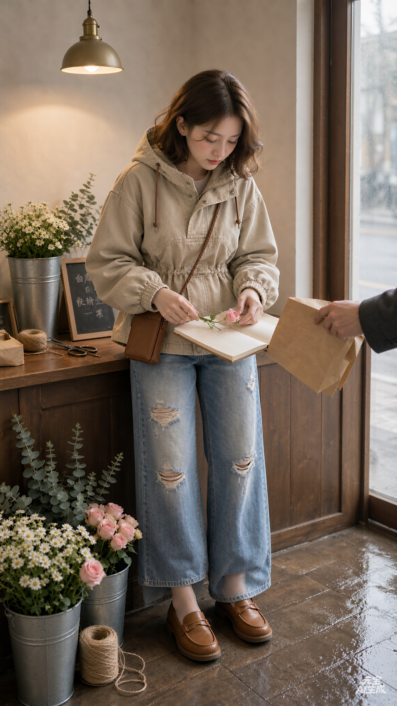

## 终稿提示词

```text
第一张图同时定本轮整套穿搭的版型、配色、面料、配饰，以及本轮发型的长度、分缝、卷度、发饰与发色；第二张图定骨相五官与同一张脸；第三张图定本张从本轮视点看到的骨架、重心、脊线肩髋、四肢折角与两手落点，本张姿势以它为准。成图只取一位唐唐，按第一张底图右上那款发型长出同一种头发，参考小图不生成第二个人，四张是同一位唐唐被连续拍下的四下。

她穿米白底粉玫瑰印花吊带裹身连衣裙，V 领交叉、腰间系带系出一只蝴蝶结、前短后长不规则荷叶边长裙、裙摆过膝；外面罩一件象牙白薄纱透视长袖开衫，灯笼袖蓬起、袖口一圈细荷叶边，薄纱下透出吊带裙的粉玫瑰印花；浅粉缎面抽绳小包搁在矮柜上；草编宽檐帽配浅粉丝带挂在门后木钩上、她头上完整露出本轮那一款短发。胸大、腰细、腿长，靠合身剪裁与线条写实呈现，成年头身比，一具身体轮廓，左右各一只手臂、每只手五根手指各自分开、两条腿各自连续。

齐下颌圆润短波波头，发尾落在她自己下颌角下约一厘米、比下巴多出一指，整体是贴头圆弧的丸形轮廓；分缝线落在她自己左侧约二八分、露出右侧额角一小块光洁额头，缝线短而浅、不发白；刘海为透光空气薄刘海、中间自然散开成细窄的人字隙而非实心中缝，帘尾参差扫在眉上方约半厘米；两侧发片顺着颧骨向内包、盖住半个耳廓、耳珠若隐若现，双耳都不往后别；无任何发饰；发尾整体做顺直微内扣的圆弧收口、齐整不带外翻翘缕，后颈发缘剪成贴脖的短齐弧、露出一段干净后颈与两只小耳垂；低头与俯身时整片发帽作为一体向她自己前方（画面右侧）顺滑垂落，额角与眉眼露在帘隙之间，两侧包耳发片贴腮滑下、长度只到下颌不会扫进手里提着的裙摆、木盆水面与膝头探店本，侧后回头时发丝整体甩向她自己右侧（画面左侧）、后颈短齐弧随之露出一截，始终不遮住手持的猫名卡与照片；发色深棕近黑茶，发梢一层极细冷灰雾感、像暮色里蒙了层薄纱，全长无挑染；在每一张里完全相同。

她的美甲是浅杏裸粉圆短甲，甲面一层极细珠光弧、甲缘干净、甲形圆短，十指一致。

本轮腿上那一层：浅茶褐匀透连裤丝袜，细密柔光织纹，从髋经膝、小腿、脚背连续包到脚尖，五趾在袜面里各自分明；粉玫瑰印花长裙之内整条腿仍由同一层袜面完整包住，提起裙摆露出的膝下到膝上一截是同一层浅茶褐袜面、与腿上同层同质；脚踝及腿上平顺无罗纹螺纹松紧收口、无横向袜边、无勒出的一圈分界；袜面平顺连进浅杏粉细带方跟凉鞋的细带之间。这一层四张逐字一致、成图里真的看得见。

鞋是浅杏粉细带方跟凉鞋，脚背两道细带、脚踝一道细扣带、方跟约三厘米，浅茶褐袜面平顺连进细带之间、五趾在袜面里各自分明。

四张同一套衣服、同一款发型、同一款美甲、同一层浅茶褐裙里丝、同一双浅杏粉细带方跟凉鞋、同一张脸。

场景是住处门厅木地板矮凳，傍晚最后一点青蓝天光从画右上木格窗斜进来，落在粉玫瑰印花裙摆、木盆水面与她发梢；暖黄落地灯从画左下补一层软光，落在浅杏粉凉鞋、毛巾与探店本纸页上；画右是没开灯的走廊暗处。道具有木盆温水、毛巾搭盆沿、矮凳、门后木钩上挂着的草编宽檐帽、浅粉缎面抽绳小包、摊开的探店本与九张照片、铅笔、那张写着「年糕」的猫名卡、一杯温水、木格窗与窗外青蓝暮色、暖黄落地灯、窗台一小盆薄荷。9:16 竖版满画幅，画面从顶到底由人物、道具与光填满，单幅一次快门，安静、轻、松弛。

【本张机位】视点离地约 88cm、距她约 1.4m，他侧身坐回矮凳平视略低，侧面中景；画框上缘齐她发顶与木格窗暮色、下缘齐木地板与矮凳腿，四分之三侧脸完整入画、不切成半张脸；看得见侧后颈肩线与粉玫瑰印花裙摆随侧身带出的缓弧，看不见窗外更远处。
【本张动作】她侧后回头朝画外的他笑，眼尾先弯、嘴角随后，一手把写着「年糕」的猫名卡举到暖黄落地灯下、五指分开，一手搭在薄毯上、五指分开；洗完的那只脚搁在他膝头、脚背浅茶褐袜面平顺连进浅杏粉细带方跟凉鞋、五趾在袜面里各自分明，三厘米的方跟离开地面、鞋尖顺着他膝头的弧度自然往下点一点，小腿线从他膝头一路收到脚尖绷成一条笔直的长弧，袜面在暮色与灯光的交界处透出一层薄薄的茶色亮；另一只脚踩实木地板；眼神先落在猫名卡那两个字上、头随后转向他，由「叫年糕啦」长出把卡片举高给他看的那一小下；颈肩连续、脊线顺着回头的弧走，齐下颌短波波头随侧后回头整体甩向一侧、后颈短齐弧露出一截，粉玫瑰印花裙摆随侧身往她自己右后方带出一道缓弧、前短后长的荷叶层次仍各自完整闭合，缓弧把侧腰收进去、胯线微微顶出来，举卡那只手抬高时薄纱袖口的一圈荷叶边垂在肩后晃了一下，落地灯从画左下把她这一侧的轮廓勾出一道暖边。两腿各自连续。全画面写着「年糕」的猫名卡有且仅有一张、就在她手里举到落地灯下，地面只有摊开的探店本与散落的照片；画右下只有他一截浅灰棉长裤膝头托着她搁上来的脚、没有第二只手也没有第二个人。她的两条腿从裙摆下缘到脚踝再到脚背与脚尖始终是同一片连续平顺的浅茶褐匀透袜面，脚踝处没有短袜套、没有罗纹收口、没有横向袜边、没有勒出的一圈分界，袜面一路包住五趾连进浅杏粉细带方跟凉鞋的细带之间。
【本张前景与填满】写「年糕」的猫名卡、木格窗与窗外青蓝暮色、窗台一小盆薄荷、门后木钩上挂着的草编宽檐帽、暖黄落地灯、薄毯一角、矮凳木纹与木地板纹，从画面顶到底把画框填满；她自己的两只手各五指分开、浅杏裸粉圆短甲与甲缘清楚，举卡片那只手的甲面在落地灯软光里亮成一排小月牙。画右上木格窗的青蓝暮色与画左下落地灯的暖黄在她腿上那层浅茶褐袜面交汇，外侧一线冷、内侧一片暖，膝与小腿的圆弧顺着这道明暗转过去，丝光薄透的层次一下就有了深浅；
【本张男主局部】画右下他一截膝头，浅灰棉长裤、托着她搁上来的那只脚，头脸完全在画外，不生成第二个人；这是本轮第二处男主局部，与第 2 张那只托脚踝的手同属他一人在场。
【本张槽3】第三张图给的是侧面坐姿、重心落在后腿、一手举猫名卡一手搭薄毯、一只脚搁在画右下他膝头上的骨架，两手落点与回头动势以它为准。
```

## 一句点评

把花平平夹进探店本后面第三页，他一只手从画右递来牛皮纸，深灰袖口压住一小片柜台的暖黄；后面还剩两页空着。
