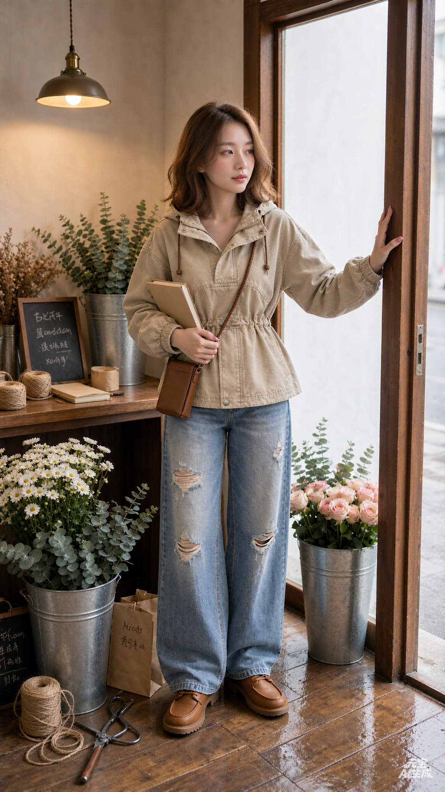
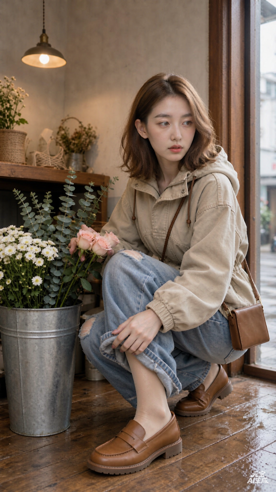
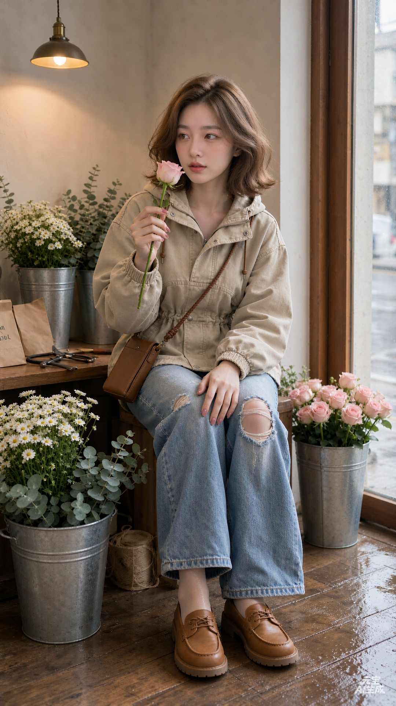

# R061 · 最矮的那一枝

- 轮次目录：`20261128c_lovers-flower-stall`
- 来源：`lovers`
- 日期：2026-11-28
- 穿搭：`AUT-0191`
- 四张线稿：`代码手搓·112cm略高侧前站姿扶门框`、`代码手搓·展示张·34cm极低机位蹲姿拉起裤脚露裤里丝`、`代码手搓·58cm低平视举浅粉玫瑰到颧骨旁`、`代码手搓·148cm略高俯把花夹进探店本第三页带画右递纸男主手`
- 画幅：1080×1920（9:16），纯画面，工具水印随图保留

## 四张

| 序 | 机位 | 图 | 终稿提示词 |
|---|---|---|---|
| 01 | front |  | [01_front.md](01_front.md) |
| 02 | side |  | [02_side.md](02_side.md) |
| 03 | seat |  | [03_seat.md](03_seat.md) |
| 04 | close |  | [04_close.md](04_close.md) |

## 这一段说了什么

1. 短话
2. 主动话题

## 现场记录

- 接
-  
- f
- i
- r
- s
- t
- _
- c
- u
- p
-  
- 主
- 动
- 话
- 题
- 「
- 等
- 会
- 儿
- 陪
- 我
- 走
- 到
- 巷
- 口
- 那
- 家
- 花
- 铺
- 好
- 不
- 好
- ？
- 我
- 探
- 店
- 本
- 后
- 面
- 还
- 空
- 着
- 三
- 页
- 呢
- 」
- ，
- 走
- 到
- 第
- 一
- 杯
- 喝
- 完
- 、
- 拐
- 进
- 巷
- 口
- 花
- 铺
- 、
- 挑
- 最
- 矮
- 的
- 一
- 枝
- 浅
- 粉
- 玫
- 瑰
- 、
- 包
- 好
- 夹
- 进
- 探
- 店
- 本
- 后
- 面
- 第
- 三
- 页
- ；
- 主
- 动
- 话
- 题
- 换
- 成
- 「
- 傍
- 晚
- 陪
- 我
- 去
- 河
- 边
- 把
- 剩
- 下
- 两
- 页
- 写
- 完
- 好
- 不
- 好
- ？
- 」
- 。
- 上
- 一
- 轮
- 店
- 内
- 靠
- 窗
- 木
- 桌
- ／
- 白
- 瓷
- 杯
- ／
- 分
- 享
- 壶
- ／
- 探
- 店
- 本
- 最
- 后
- 一
- 页
-  
- →
-  
- 本
- 轮
- 花
- 铺
- ／
- 镀
- 锌
- 花
- 桶
- ／
- 牛
- 皮
- 纸
- 棉
- 绳
- 花
- 剪
- ／
- 后
- 面
- 三
- 页
- ，
- 道
- 具
- 链
- 整
- 条
- 换
- 过
- 。
- 点
- 踩
- 口
- 径
- 继
- 续
- 生
- 效
- ：
- P
- R
- E
- F
- E
- R
- E
- N
- C
- E
- S
- .
- m
- d
-  
- 五
- 节
- 记
- 的
-  
- d
- a
- w
- n
- _
- q
- u
- e
- u
- e
-  
- 那
- 款
- （
- 及
- 肩
- 下
- 两
- 指
- 厚
- 重
- 齐
- 刘
- 海
- 短
- 直
- 发
- 、
- 分
- 缝
- 藏
- 刘
- 海
- 、
- 发
- 尾
- 三
- 厘
- 米
- 内
- 扣
- 圆
- 钝
- 弧
- 、
- 深
- 墨
- 黑
- 暖
- 栗
- 雾
- ）
- 不
- 复
- 用
- ；
- 本
- 轮
-  
- 2
- .
- 5
-  
- 按
- 新
- 合
- 成
- 槽
-  
- 1
-  
- 重
- 新
- 设
- 计
- 的
- 锁
- 骨
- 上
- 两
- 指
- 蓬
- 松
- 微
- 卷
- 中
- 长
- 发
- （
- 二
- 八
- 侧
- 分
- 露
- 额
- 、
- 发
- 尾
- 参
- 差
- 外
- 翘
- 、
- 浅
- 栗
- 棕
- 冷
- 茶
- 雾
- ）
- 与
- 点
- 踩
- 款
- 五
- 项
- 全
- 不
- 同
- 、
- 与
- 上
- 一
- 轮
- 过
- 肩
- 中
- 分
- 长
- 直
- 发
- 也
- 五
- 项
- 全
- 不
- 同
- ；
- 短
- 发
- ／
- 齐
- 刘
- 海
- 品
- 类
- 仍
- 合
- 法
- 、
- 不
- 算
- 拉
- 黑
- ；
- R
- 0
- 5
- 8
-  
- 未
- 回
- 滚
- 未
- 重
- 出
- 。
- 槽
-  
- 1
- ＝
- A
- U
- T
- -
- 0
- 1
- 9
- 1
-  
- a
- u
- t
- u
- m
- n
- /
- b
- o
- t
- t
- o
- m
- （
- -
- -
- f
- r
- e
- s
- h
-  
- -
- -
- s
- e
- e
- d
-  
- 7
- ）
- 燕
- 麦
- 米
- 色
- 收
- 腰
- 连
- 帽
- 工
- 装
- 夹
- 克
- ＋
- 浅
- 蓝
- 水
- 洗
- 破
- 洞
- 阔
- 腿
- 牛
- 仔
- 长
- 裤
- ＋
- 焦
- 糖
- 棕
- 皮
- 革
- 斜
- 挎
- 小
- 方
- 包
- ＋
- 焦
- 糖
- 棕
- 厚
- 底
- 乐
- 福
- 船
- 鞋
- ＋
- 发
- 型
- 参
- 考
-  
- f
- d
- a
- a
- b
- f
- 3
- 8
- 7
- 8
- e
-  
- m
- e
- d
- i
- u
- m
- /
- f
- a
- c
- e
- 。
- 下
- 装
- 长
- 裤
- （
- 裤
- 管
- 过
- 踝
- ）
- →
-  
- 裤
- 里
- 丝
- ＝
- 奶
- 杏
- 珠
- 光
- 匀
- 透
- 连
- 裤
- 丝
- 袜
- ，
- 从
- 髋
- 经
- 膝
- 到
- 脚
- 尖
- 连
- 续
- 、
- 破
- 洞
- 里
- 透
- 出
- 同
- 一
- 片
- 袜
- 面
- 、
- 平
- 顺
- 连
- 进
- 乐
- 福
- 鞋
- 口
- 、
- B
- 5
- -
- C
-  
- 无
- 罗
- 纹
- 收
- 口
- ；
- 不
- 是
- 裙
- 里
- 丝
- 。
- 按
-  
- L
- E
- G
- _
- S
- H
- O
- W
- .
- m
- d
-  
- 二
- 节
- 长
- 裤
- 轮
- 触
- 发
- 展
- 示
- 张
- ：
- 展
- 示
- 张
- ＝
- 第
-  
- 2
-  
- 张
- ，
- 右
- 手
- 五
- 指
- 捏
- 住
- 右
- 裤
- 管
- 下
- 缘
- 往
- 上
- 提
- 一
- 小
- 截
- 、
- 露
- 脚
- 踝
- 上
- 到
- 小
- 腿
- 中
- 段
- 那
- 一
- 截
- 裤
- 里
- 丝
- 给
- 画
- 外
- 的
- 他
- 看
- ，
- 场
- 景
- 理
- 由
- 是
- 花
- 铺
- 地
- 上
- 洒
- 过
- 水
- 蹲
- 下
- 挑
- 花
- 时
- 裤
- 脚
- 沾
- 湿
- ；
- 槽
-  
- 3
- ＝
- 第
-  
- 2
-  
- 步
- 代
- 码
- 手
- 搓
- ·
- 展
- 示
- 张
- （
- 五
- 步
- 画
- 法
- ，
- 重
- 画
- 一
- 版
- 后
- 亲
- 看
- 通
- 过
- ）
- ，
- 其
- 余
- 三
- 张
- 代
- 码
- 手
- 搓
- ，
- 库
- 图
- 留
-  
- s
- l
- o
- t
- s
- /
- _
- b
- a
- c
- k
- u
- p
- /
- ，
- 四
- 张
- 恰
- 有
- 一
- 张
- 展
- 示
- 张
- 。
- 四
- 张
- 取
- 景
-  
- 1
- 1
- 2
- /
- 3
- 4
- /
- 5
- 8
- /
- 1
- 4
- 8
- c
- m
-  
- 逐
- 张
- 单
- 独
- 设
- 计
- ，
- 与
- 上
- 一
- 轮
-  
- 7
- 8
- /
- 1
- 3
- 2
- /
- 4
- 4
- /
- 1
- 0
- 8
- c
- m
- 、
- 上
- 上
- 轮
-  
- 1
- 6
- 5
- /
- 5
- 0
- /
- 1
- 2
- 0
- /
- 9
- 6
- c
- m
-  
- 整
- 条
- 错
- 开
- ，
- 不
- 套
- 三
- 远
- 一
- 近
- 、
- 末
- 张
- 非
- 双
- 手
- 特
- 写
- ；
- 男
- 主
- 局
- 部
-  
- 0
- /
- 0
- /
- 0
- /
- 1
- （
- 仅
- 第
-  
- 4
-  
- 张
- 画
- 右
- 他
- 一
- 只
- 手
- 递
- 牛
- 皮
- 纸
- 、
- 天
- 然
- 短
- 甲
- 素
- 甲
- 、
- 深
- 灰
- 呢
- 料
- 袖
- 口
- 、
- 头
- 脸
- 画
- 外
- ）
- 。
- 6
- .
- 8
-  
- 判
- 据
- 归
- 元
- 宝
- 自
- 己
- ：
- 第
-  
- 1
-  
- 轮
- 判
- 第
-  
- 2
-  
- 张
- 展
- 示
- 张
- 不
- 合
- 格
- （
- 露
- 出
- 那
- 一
- 截
- 是
- 光
- 裸
- 皮
- 肤
- 、
- 腿
- 层
- 整
- 段
- 缺
- 席
- ）
- ，
- 走
- 单
- 图
- 一
- 条
- 许
- 愿
- 式
- （
- s
- e
- e
- d
- =
- 9
- ）
- 补
- 出
- 一
- 层
- 均
- 匀
- 柔
- 亮
- 近
- 肤
- 色
- 薄
- 透
- 珠
- 光
- 袜
- 面
- ，
- 第
-  
- 2
-  
- 轮
- 判
- 四
- 张
- 全
- 合
- 格
- ；
- 首
- 版
- 备
- 份
-  
- o
- u
- t
- /
- _
- b
- a
- c
- k
- u
- p
- /
- 2
- _
- 首
- 版
- _
- 光
- 腿
- .
- p
- n
- g
- ，
- 未
- 叠
- 加
- 第
- 二
- 条
- 许
- 愿
- 式
- 。
- 如
- 实
- 记
- ：
- 那
- 一
- 截
- 是
- 薄
- 透
- 近
- 肤
- 色
- 观
- 感
- 、
- 不
- 是
- 明
- 显
- 异
- 色
- 厚
- 袜
- ，
- 按
- 历
- 轮
- （
- 含
-  
- R
- 0
- 1
- 7
-  
- 修
- 正
- 轮
- ）
- 口
- 径
- 判
- 合
- 法
- ，
- 不
- 包
- 装
- 成
- 明
- 显
- 奶
- 杏
- 色
- 丝
- 袜
- 。
- 遗
- 留
- 轻
- 项
- ：
- 展
- 示
- 张
- 成
- 图
- 读
- 成
- 坐
- 木
- 台
- 阶
- 一
- 腿
- 屈
- 起
- 而
- 非
- 蹲
- 在
- 花
- 桶
- 前
- 、
- 图
-  
- 4
-  
- 站
- 姿
- 俯
- 身
- 夹
- 本
- 子
- 且
- 牛
- 皮
- 纸
- 袋
- 略
- 大
- 、
- 图
-  
- 1
-  
- 破
- 洞
- 与
- 图
-  
- 3
-  
- 脚
- 踝
- 那
- 一
- 小
- 截
- 薄
- 透
- 近
- 肤
- 色
- 观
- 感
- 、
- 修
- 后
- 图
-  
- 2
-  
- 去
- 了
- 角
- 标
- 其
- 余
- 三
- 张
- 仍
- 在
- （
- 水
- 印
- 无
- 所
- 谓
- ）
- 。
- 本
- 会
- 话
- 无
- 独
- 立
- 研
- 究
- 员
- 与
- 作
- 家
- 委
- 托
- 入
- 口
- ：
- 第
-  
- 6
-  
- 步
- 验
- 图
- 与
-  
- 6
- .
- 8
-  
- 第
- 三
- 方
- 意
- 见
- 职
- 能
- 由
- 元
- 宝
- 按
- 核
- 项
- 自
- 行
- 亲
- 看
- 承
- 担
- 、
- 6
- .
- 5
-  
- 文
- 章
- 由
- 元
- 宝
- 据
- 四
- 张
- 图
- 成
- 文
- ，
- 不
- 包
- 装
- 成
- 研
- 究
- 员
- 判
- 合
- 格
- 或
- 作
- 家
- 成
- 文
- 。
- 第
-  
- 4
-  
- 步
- 四
- 次
- 并
- 行
- 一
- 次
- 全
- 成
- ，
- f
- i
- t
-  
- 跑
-  
- 2
-  
- 次
- ，
- 四
- 份
- 定
- 稿
- 零
- 处
- 解
- 冻
- ，
- 四
- 份
- 公
- 共
- 段
-  
- h
- a
- s
- h
-  
- 一
- 致
- 。

> 原图 PNG 永不转码、永不覆盖；预览用 `` 缩放原图。
> 另有 `essay.md` 为本轮第一人称文章留证。
