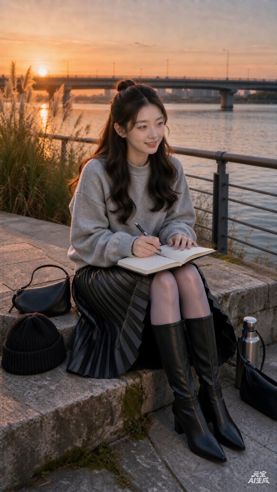

## 终稿提示词

```text
第一张图同时定本轮整套穿搭的版型、配色、面料、配饰，以及本轮发型的长度、分缝、卷度、发饰与发色；第二张图定骨相五官与同一张脸；第三张图定本张从本轮视点看到的骨架、重心、脊线肩髋、四肢折角与两手落点，本张姿势以它为准。成图只取一位唐唐，按第一张底图右上那款发型长出同一种头发，参考小图不生成第二个人，四张是同一位唐唐被连续拍下的四下。

她穿米白底粉玫瑰印花吊带裹身连衣裙，V 领交叉、腰间系带系出一只蝴蝶结、前短后长不规则荷叶边长裙、裙摆过膝；外面罩一件象牙白薄纱透视长袖开衫，灯笼袖蓬起、袖口一圈细荷叶边，薄纱下透出吊带裙的粉玫瑰印花；浅粉缎面抽绳小包搁在矮柜上；草编宽檐帽配浅粉丝带挂在门后木钩上、她头上完整露出本轮那一款短发。胸大、腰细、腿长，靠合身剪裁与线条写实呈现，成年头身比，一具身体轮廓，左右各一只手臂、每只手五根手指各自分开、两条腿各自连续。

齐下颌圆润短波波头，发尾落在她自己下颌角下约一厘米、比下巴多出一指，整体是贴头圆弧的丸形轮廓；分缝线落在她自己左侧约二八分、露出右侧额角一小块光洁额头，缝线短而浅、不发白；刘海为透光空气薄刘海、中间自然散开成细窄的人字隙而非实心中缝，帘尾参差扫在眉上方约半厘米；两侧发片顺着颧骨向内包、盖住半个耳廓、耳珠若隐若现，双耳都不往后别；无任何发饰；发尾整体做顺直微内扣的圆弧收口、齐整不带外翻翘缕，后颈发缘剪成贴脖的短齐弧、露出一段干净后颈与两只小耳垂；低头与俯身时整片发帽作为一体向她自己前方（画面右侧）顺滑垂落，额角与眉眼露在帘隙之间，两侧包耳发片贴腮滑下、长度只到下颌不会扫进手里提着的裙摆、木盆水面与膝头探店本，侧后回头时发丝整体甩向她自己右侧（画面左侧）、后颈短齐弧随之露出一截，始终不遮住手持的猫名卡与照片；发色深棕近黑茶，发梢一层极细冷灰雾感、像暮色里蒙了层薄纱，全长无挑染；在每一张里完全相同。

她的美甲是浅杏裸粉圆短甲，甲面一层极细珠光弧、甲缘干净、甲形圆短，十指一致。

本轮腿上那一层：浅茶褐匀透连裤丝袜，细密柔光织纹，从髋经膝、小腿、脚背连续包到脚尖，五趾在袜面里各自分明；粉玫瑰印花长裙之内整条腿仍由同一层袜面完整包住，提起裙摆露出的膝下到膝上一截是同一层浅茶褐袜面、与腿上同层同质；脚踝及腿上平顺无罗纹螺纹松紧收口、无横向袜边、无勒出的一圈分界；袜面平顺连进浅杏粉细带方跟凉鞋的细带之间。这一层四张逐字一致、成图里真的看得见。

鞋是浅杏粉细带方跟凉鞋，脚背两道细带、脚踝一道细扣带、方跟约三厘米，浅茶褐袜面平顺连进细带之间、五趾在袜面里各自分明。

四张同一套衣服、同一款发型、同一款美甲、同一层浅茶褐裙里丝、同一双浅杏粉细带方跟凉鞋、同一张脸。

场景是住处门厅木地板矮凳，傍晚最后一点青蓝天光从画右上木格窗斜进来，落在粉玫瑰印花裙摆、木盆水面与她发梢；暖黄落地灯从画左下补一层软光，落在浅杏粉凉鞋、毛巾与探店本纸页上；画右是没开灯的走廊暗处。道具有木盆温水、毛巾搭盆沿、矮凳、门后木钩上挂着的草编宽檐帽、浅粉缎面抽绳小包、摊开的探店本与九张照片、铅笔、那张写着「年糕」的猫名卡、一杯温水、木格窗与窗外青蓝暮色、暖黄落地灯、窗台一小盆薄荷。9:16 竖版满画幅，画面从顶到底由人物、道具与光填满，单幅一次快门，安静、轻、松弛。

【本张机位】视点离地约 76cm、距她约 1.0m，他坐在矮凳侧后方平视偏下；画框上缘齐她发顶、下缘齐矮凳腿与两只浅杏粉细带方跟凉鞋，让被提起那一截裙里丝真的看得见，不收成只留一线下巴或唇角的极近特写，也不裁成只剩腿。看得见她坐定后侧转、一手捏裙摆一手搭凳边、抬眼看向画外的他；看不见背后走廊暗处的更深处。
【本张动作】本轮那一层是裙里丝。她在矮凳上坐定后头微朝画外的他侧转，右手沿自己身体外侧下来、五指分开捏住自己左侧那一小段裙摆的布边、只把那一小段往上提起一小截，露出膝下到膝上一截浅茶褐裙里丝；左手搭在矮凳边、五指分开；眼神落向画外他坐着的那个位置，身体、膝与脚尖朝他侧转，提着裙摆停住给他看，头随后微偏，眼尾从薄刘海的帘隙底下斜斜送出去。V领交叉压出的锁骨窝与颈肩那条线正接住画右上木格窗的青蓝天光，提裙摆这一下腰侧顺着侧转自然送出一道窄弧，裹身裙的系带蝴蝶结跟着微微偏向他那一侧；露出那一截浅茶褐袜面在膝头弯起的地方亮起一道最细的柔光边，往下收到小腿渐渐暗回去，腿线显得比平时更长一截。露出的那一截与腿上同层同质、是同一层浅茶褐匀透袜面，细密柔光织纹在落地灯软光里柔柔发亮；被提起的只有手捏住的那一小段布边，有一道折线与两三道轻褶，整片粉玫瑰印花荷叶裙摆其余部分自然垂落并完整闭合、前短后长的层次仍清楚；两腿各自连续，被提那侧的脚仍穿在浅杏粉细带方跟凉鞋里踩实木地板，脚踝及腿上平顺无罗纹螺纹松紧收口、无横向袜边、无勒出的一圈分界。这一下像专门提给坐着的那个人看，颈肩连续、脊线顺着侧转的弧走。右手真的五指分开捏住自己左侧那一小段裙摆的布边往上提起一小截，虎口上方拎出一个朝上的小布尖与两道轻褶，只露出膝下到膝上一截浅茶褐裙里丝，整片粉玫瑰印花荷叶裙摆其余部分铺过膝自然垂落并各自完整闭合，提住不动的那一瞬布边折影落在这一截袜面上。她的两条腿从裙摆下缘到脚踝再到脚背与脚尖始终是同一片连续平顺的浅茶褐匀透袜面，脚踝处没有短袜套、没有罗纹收口、没有横向袜边、没有勒出的一圈分界，袜面一路包住五趾连进浅杏粉细带方跟凉鞋的细带之间。
【本张前景与填满】粉玫瑰印花裙摆与被提起的那一小段布边折痕、露出的那一截浅茶褐袜面、矮凳木纹、两只浅杏粉细带方跟凉鞋、木地板纹与暖黄落地灯光斑，从画面顶到底把画框填满；她自己的两只手各五指分开、浅杏裸粉圆短甲清楚，捏布边那只手的五指与甲缘都看得清。捏布那手的食指与拇指压在布边折线上、其余三指自然错开，浅杏裸粉圆短甲的珠光弧正落在折影旁边，提住不动的这一瞬裙摆轻褶的影子在袜面上投出两三道细横纹。画右上木格窗的青蓝暮色与画左下落地灯的暖黄在她腿上那层浅茶褐袜面交汇，外侧一线冷、内侧一片暖，膝与小腿的圆弧顺着这道明暗转过去，丝光薄透的层次一下就有了深浅；
【本张男主局部】这一张不出现男主的任何局部，「给画外的他看」由她的视线、身体与膝脚尖朝他侧转、提着裙摆停住这三个可见动作承担，画面是她一人在矮凳上低头侧转。
【本张槽3】第三张图给的是平视偏下坐姿、重心落在坐下那条腿、一手沿身体外侧下来捏住本侧裙摆往上提一小截、另一手搭凳边、两腿各自连续到两只鞋的骨架；这张线稿是本轮展示张的代码手搓线稿，动作与骨架以它为准。
```

## 一句点评

坐在河堤石阶上写最后两页，侧后回头朝他笑，画左落日把河面烧成一条暖橘带，桥影压在远处。
