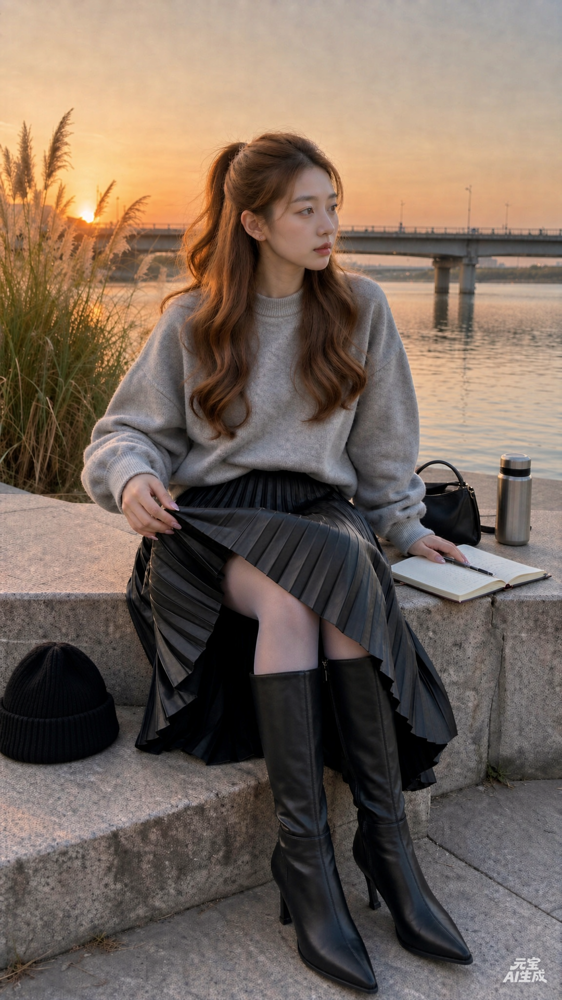

# R063 · 日落以前，我总想把话说完

- 轮次目录：`20261128d_lovers-riverbank-pages`
- 来源：`lovers`
- 日期：2026-11-28
- 穿搭：`WIN-0220`
- 四张线稿：`代码手搓·96cm侧后坐姿回头写本`、`代码手搓·152cm略高俯写最后一行带画右放杯男主手`、`代码手搓·展示张·40cm极低平视提起裙摆露裙里丝`、`代码手搓·124cm平视举本对落日看一脚踩上一级石阶`
- 画幅：1080×1920（9:16），纯画面，工具水印随图保留

## 四张

| 序 | 机位 | 图 | 终稿提示词 |
|---|---|---|---|
| 01 | front |  | [01_front.md](01_front.md) |
| 02 | side |  | [02_side.md](02_side.md) |
| 03 | seat |  | [03_seat.md](03_seat.md) |
| 04 | close |  | [04_close.md](04_close.md) |

## 这一段说了什么

1. 短话
2. 主动话题

## 现场记录

- 接
-  
- f
- l
- o
- w
- e
- r
- _
- s
- t
- a
- l
- l
-  
- 主
- 动
- 话
- 题
- 「
- 傍
- 晚
- 陪
- 我
- 去
- 河
- 边
- 把
- 它
- 们
- 写
- 完
- 好
- 不
- 好
- ？
- 」
- ，
- 走
- 到
- 傍
- 晚
- 河
- 堤
- 石
- 阶
- 把
- 探
- 店
- 本
- 后
- 面
- 剩
- 下
- 两
- 页
- 写
- 完
- 、
- 最
- 后
- 一
- 行
- 画
- 了
- 只
- 歪
- 歪
- 的
- 猫
- ；
- 主
- 动
- 话
- 题
- 「
- 你
- 猜
- 我
- 把
- 明
- 早
- 那
- 页
- 空
- 着
- 留
- 给
- 谁
- ？
- 」
- 。
- 上
- 一
- 轮
- 巷
- 口
- 花
- 铺
- 室
- 内
- ／
- 镀
- 锌
- 花
- 桶
- ／
- 牛
- 皮
- 纸
- 棉
- 绳
-  
- →
-  
- 本
- 轮
- 傍
- 晚
- 河
- 堤
- 石
- 阶
- ／
- 芦
- 苇
- 铁
- 栏
- 杆
- 桥
- 影
- ／
- 摊
- 开
- 最
- 后
- 两
- 页
- 的
- 探
- 店
- 本
- ／
- 针
- 管
- 笔
- ／
- 保
- 温
- 杯
- ／
- 摘
- 下
- 的
- 冷
- 帽
- ，
- 场
- 景
- 道
- 具
- 链
- 双
- 光
- 位
- 整
- 条
- 换
- 过
- 。
- 用
- 户
- 当
- 面
- 要
- 求
- 读
-  
- S
- K
- I
- L
- L
- .
- m
- d
-  
- 严
- 格
- 执
- 行
- 、
- 继
- 续
- 推
- 进
- ；
- 本
- 轮
- 真
- 派
- 第
- 三
- 方
- ：
- 2
- .
- 5
-  
- 发
- 型
- 研
- 究
- 员
- （
- 据
- 重
- 拼
- 槽
-  
- 1
-  
- 给
- 逐
- 字
- 串
- ）
- 、
- 第
-  
- 3
-  
- 步
- 审
- 校
-  
- A
- g
- e
- n
- t
- （
- 1
- 8
-  
- 岁
- 男
- 大
- 老
- 色
- 批
- 人
- 设
- 逐
- 份
- 读
- 四
- 份
- 给
- 正
- 向
- 补
- 写
- 句
- ）
- 、
- 6
- .
- 8
-  
- 单
- 图
- 研
- 究
- 员
- ＋
- 总
- 审
- （
- 全
- 量
- 资
- 料
- 包
- 按
-  
- 1
- 0
-  
- 序
- 读
- 、
- 真
- 出
- 审
- 稿
- 单
- ）
- 、
- 6
- .
- 5
-  
- 作
- 家
- （
- 只
- 拿
- 四
- 张
-  
- o
- u
- t
-  
- 绝
- 对
- 路
- 径
- 成
- 文
- ）
- ；
- 第
-  
- 6
-  
- 步
- 未
- 单
- 独
- 派
- 满
-  
- 4
-  
- 个
- 验
- 图
- 研
- 究
- 员
- ，
- 由
- 元
- 宝
- 按
- 核
- 项
- 逐
- 张
- 承
- 担
- ，
- 如
- 实
- 记
- 。
- 判
- 据
- 仍
- 归
- 元
- 宝
- 自
- 己
- 四
- 张
- 同
- 屏
- 亲
- 看
- ＋
- 逐
- 张
- 放
- 大
- 。
- 点
- 踩
- 口
- 径
- 继
- 续
- 生
- 效
- ：
- P
- R
- E
- F
- E
- R
- E
- N
- C
- E
- S
- .
- m
- d
-  
- 五
- 节
- 被
- 点
- 踩
- 的
-  
- d
- a
- w
- n
- _
- q
- u
- e
- u
- e
-  
- 那
- 款
- （
- 及
- 肩
- 下
- 两
- 指
- 厚
- 重
- 齐
- 刘
- 海
- 短
- 直
- 发
- 、
- 分
- 缝
- 藏
- 刘
- 海
- 、
- 发
- 尾
- 三
- 厘
- 米
- 内
- 扣
- 圆
- 钝
- 弧
- 、
- 深
- 墨
- 黑
- 暖
- 栗
- 雾
- ）
- 不
- 复
- 用
- ；
- -
- -
- s
- l
- o
- t
- 1
-  
- 首
- 挑
-  
- f
- 1
- 1
- 2
- 8
- d
- f
- 0
- 8
- d
- b
-  
- h
- a
- i
- r
- =
- s
- h
- o
- r
- t
-  
- 是
- 「
- ミ
- ニ
- ボ
- ブ
- （
- オ
- ン
- 眉
- ぱ
- っ
- つ
- ん
- 前
- 髪
- ）
- 」
- 及
- 眉
- 厚
- 重
- 齐
- 刘
- 海
- 迷
- 你
- 波
- 波
- 头
- 、
- 与
- 点
- 踩
- 那
- 串
- 几
- 乎
- 同
- 款
- ，
- 按
- 「
- 库
- 图
- 不
- 合
- 适
- 就
- 重
- 挑
- 」
- 保
- 留
-  
- W
- I
- N
- -
- 0
- 2
- 2
- 0
-  
- 服
- 装
- 图
- 、
- -
- -
- p
- i
- c
- k
- -
- h
- a
- i
- r
- -
- r
- e
- f
-  
- -
- -
- h
- a
- i
- r
-  
- l
- o
- n
- g
-  
- 改
- 挑
-  
- f
- 5
- 8
- a
- 4
- 8
- 2
- c
- 9
- 4
- 6
- 、
- 用
-  
- c
- o
- m
- p
- o
- s
- e
- _
- s
- l
- o
- t
- 1
- .
- p
- y
-  
- b
- o
- a
- r
- d
-  
- 版
- 式
- 重
- 拼
- 槽
-  
- 1
- ，
- 首
- 挑
- 版
- 留
- 证
-  
- s
- l
- o
- t
- s
- /
- _
- b
- a
- c
- k
- u
- p
- /
- 。
- 本
- 轮
-  
- 2
- .
- 5
-  
- 串
- （
- 背
- 腰
- 中
- 段
- 高
- 束
- 半
- 扎
- 大
-  
- S
-  
- 水
- 波
- 长
- 卷
- 、
- 正
- 中
- 中
- 分
- 全
- 露
- 额
- 、
- 蜜
- 糖
- 琥
- 珀
- 金
- 暖
- 茶
- 棕
- 亮
- 缎
- ）
- 与
- 点
- 踩
- 款
- 五
- 项
- 全
- 不
- 同
- 、
- 与
- 前
- 两
- 轮
- 也
- 全
- 不
- 同
- ；
- 短
- 发
- ／
- 齐
- 刘
- 海
- 品
- 类
- 仍
- 合
- 法
- 不
- 算
- 拉
- 黑
- ；
- R
- 0
- 5
- 8
-  
- 未
- 回
- 滚
- 未
- 重
- 出
- 。
- 槽
-  
- 1
- ＝
- W
- I
- N
- -
- 0
- 2
- 2
- 0
-  
- w
- i
- n
- t
- e
- r
- /
- s
- k
- i
- r
- t
- （
- -
- -
- f
- r
- e
- s
- h
-  
- -
- -
- s
- e
- e
- d
-  
- 4
- ）
- 浅
- 麻
- 灰
- 宽
- 松
- 圆
- 领
- 落
- 肩
- 毛
- 衣
- ＋
- 黑
- 色
- 高
- 腰
- 过
- 膝
- 细
- 密
- 刀
- 褶
- 皮
- 质
- 长
- 裙
- ＋
- 黑
- 色
- 皮
- 革
- 小
- 腋
- 下
- 包
- ＋
- 黑
- 色
- 及
- 膝
- 下
- 长
- 筒
- 尖
- 头
- 细
- 跟
- 靴
- ＋
- 黑
- 色
- 针
- 织
- 冷
- 帽
- 摘
- 下
- 搁
- 石
- 阶
- ；
- 美
- 甲
- 雾
- 感
- 藕
- 紫
- 圆
- 短
- 甲
- ＋
- 极
- 细
- 暖
- 银
- 弧
- 。
- 下
- 装
- 长
- 裙
- （
- 裙
- 摆
- 过
- 膝
- 到
- 小
- 腿
- 中
- 段
- ）
- →
-  
- 裙
- 里
- 丝
- ＝
- 雾
- 紫
- 灰
- 珠
- 光
- 匀
- 透
- 连
- 裤
- 丝
- 袜
- 、
- 从
- 髋
- 经
- 膝
- 到
- 脚
- 尖
- 连
- 续
- 、
- 坐
- 石
- 阶
- 裙
- 摆
- 上
- 堆
- 露
- 一
- 小
- 截
- 、
- 平
- 顺
- 连
- 进
- 长
- 筒
- 靴
- 筒
- 、
- B
- 5
- -
- C
-  
- 无
- 罗
- 纹
- 收
- 口
- ；
- 不
- 是
- 裤
- 里
- 丝
- 。
- 按
-  
- L
- E
- G
- _
- S
- H
- O
- W
- .
- m
- d
-  
- 二
- 节
- 长
- 裙
- 轮
- 触
- 发
- 展
- 示
- 张
- ：
- 第
-  
- 3
-  
- 张
- 右
- 手
- 五
- 指
- 钳
- 形
- 捏
- 住
- 自
- 己
- 左
- 侧
- 一
- 小
- 段
- 黑
- 色
- 百
- 褶
- 裙
- 摆
- 往
- 上
- 提
- 一
- 小
- 截
- 、
- 露
- 膝
- 上
- 到
- 大
- 腿
- 下
- 段
- 那
- 一
- 截
- 裙
- 里
- 丝
- 给
- 画
- 外
- 的
- 他
- 看
- ，
- 场
- 景
- 理
- 由
- 是
- 傍
- 晚
- 河
- 风
- 把
- 百
- 褶
- 裙
- 摆
- 掀
- 起
- （
- 上
- 一
- 轮
- 是
- 裤
- 脚
- 沾
- 水
- ，
- 理
- 由
- 不
- 重
- 复
- ）
- ；
- 槽
-  
- 3
- ＝
- 第
-  
- 2
-  
- 步
- 代
- 码
- 手
- 搓
- ·
- 展
- 示
- 张
- （
- 五
- 步
- 画
- 法
- ，
- 重
- 画
- 一
- 版
- 并
- 微
- 调
- ）
- ，
- 其
- 余
- 三
- 张
- 代
- 码
- 手
- 搓
- ，
- 库
- 图
- 留
-  
- s
- l
- o
- t
- s
- /
- _
- b
- a
- c
- k
- u
- p
- /
- ，
- 四
- 张
- 恰
- 有
- 一
- 张
- 展
- 示
- 张
- ，
- 展
- 示
- 张
- 由
- 上
- 一
- 轮
- 第
-  
- 2
-  
- 张
- 移
- 到
- 第
-  
- 3
-  
- 张
- 。
- 四
- 张
- 取
- 景
-  
- 9
- 6
- /
- 1
- 5
- 2
- /
- 4
- 0
- /
- 1
- 2
- 4
- c
- m
-  
- 逐
- 张
- 单
- 独
- 设
- 计
- ，
- 与
- 上
- 一
- 轮
-  
- 1
- 1
- 2
- /
- 3
- 4
- /
- 5
- 8
- /
- 1
- 4
- 8
- c
- m
- 、
- 上
- 上
- 轮
-  
- 7
- 8
- /
- 1
- 3
- 2
- /
- 4
- 4
- /
- 1
- 0
- 8
- c
- m
-  
- 整
- 条
- 错
- 开
- ，
- 不
- 套
- 三
- 远
- 一
- 近
- 、
- 末
- 张
- 非
- 双
- 手
- 特
- 写
- ；
- 男
- 主
- 局
- 部
-  
- 0
- /
- 1
- /
- 0
- /
- 0
- （
- 仅
- 第
-  
- 2
-  
- 张
- 画
- 右
- 上
- 缘
- 他
- 一
- 只
- 手
- 把
- 不
- 锈
- 钢
- 保
- 温
- 杯
- 放
- 到
- 石
- 阶
- 上
- 、
- 天
- 然
- 短
- 甲
- 素
- 甲
- 、
- 深
- 灰
- 呢
- 料
- 袖
- 口
- 、
- 头
- 脸
- 画
- 外
- ）
- 。
- 6
- .
- 8
-  
- 判
- 据
- 归
- 元
- 宝
- 自
- 己
- ：
- 第
-  
- 1
-  
- 轮
- 判
- 四
- 张
- 腿
- 层
- 都
- 不
- 合
- 格
- （
- 裙
- 摆
- 与
- 长
- 筒
- 靴
- 之
- 间
- 露
- 出
- 的
- 那
- 一
- 截
- 是
- 光
- 裸
- 皮
- 肤
- 、
- 腿
- 层
- 整
- 层
- 缺
- 席
- ）
- ，
- 四
- 张
- 各
- 一
- 条
- 单
- 图
- 许
- 愿
- 式
- （
- s
- e
- e
- d
- =
- 6
- ）
- 补
- 出
- 一
- 层
- 冷
- 调
- 匀
- 净
- 偏
- 灰
- 紫
- 的
- 薄
- 透
- 柔
- 亮
- 面
- 、
- 与
- 黑
- 裙
- 黑
- 靴
- 有
- 材
- 质
- 分
- 界
- ，
- 第
-  
- 2
-  
- 轮
- 判
- 四
- 张
- 全
- 合
- 格
- ；
- 首
- 版
- 四
- 张
- 留
- 证
-  
- o
- u
- t
- /
- _
- b
- a
- c
- k
- u
- p
- /
- ，
- 未
- 叠
- 加
- 第
- 三
- 条
- 许
- 愿
- 式
- 。
- 如
- 实
- 记
- ：
- 四
- 张
- 裙
- 里
- 丝
- 渲
- 成
- 薄
- 透
- 偏
- 冷
- 调
- 珠
- 光
- 面
- 、
- 按
- 更
- 严
- 眼
- 光
- 仍
- 偏
- 裸
- 感
- ，
- 两
- 次
- 许
- 愿
- 式
- 未
- 补
- 出
- 明
- 显
- 雾
- 紫
- 灰
- 厚
- 袜
- ；
- 第
-  
- 3
-  
- 张
- 三
- 道
- 细
- 刀
- 褶
- 翻
- 开
- 没
- 落
- 地
- 、
- 布
- 尖
- 折
- 线
- 简
- 化
- 成
- 一
- 道
- 斜
- 折
- 线
- 、
- 裙
- 摆
- 有
- 前
- 短
- 后
- 长
- 开
- 片
- 观
- 感
- 但
- 整
- 体
- 仍
- 是
- 同
- 一
- 条
- 闭
- 合
- 百
- 褶
- 裙
- ；
- 四
- 张
- 成
- 图
- 都
- 读
- 成
- 坐
- 石
- 阶
- ；
- 图
-  
- 2
-  
- 两
- 只
- 保
- 温
- 杯
- ；
- 角
- 标
- 按
- 无
- 所
- 谓
- 保
- 留
- 。
- 审
- 稿
- 单
- 采
- 纳
- ／
- 不
- 采
- 纳
- 逐
- 条
- 见
-  
- r
- e
- v
- i
- e
- w
- /
- 元
- 宝
- 自
- 审
- _
- 2
- 0
- 2
- 6
- 1
- 1
- 2
- 8
- .
- m
- d
- ：
- 单
- 图
- 判
- 全
- 合
- 格
- 采
- 纳
- 为
- 输
- 入
- 但
- 不
- 照
- 抄
- 其
- 偏
- 乐
- 观
- 像
- 素
- 描
- 述
- 、
- 总
- 审
- 判
- 「
- 四
- 张
- 深
- 浅
- 不
- 一
- 不
- 合
- 格
- （
- 轻
- ）
- 」
- 不
- 采
- 纳
- 为
- 不
- 合
- 格
- 而
- 采
- 纳
- 其
- 「
- 以
- 第
-  
- 3
-  
- 张
- 为
- 基
- 准
- 、
- 深
- 浅
- 差
- 属
- 光
- 照
- 不
- 返
- 工
- 」
- 裁
- 决
- 口
- 径
- 、
- 局
- 部
- 提
- 亮
- 与
- 再
- 补
- 一
- 次
- 许
- 愿
- 式
- 均
- 不
- 采
- 纳
- 。
- 6
- .
- 5
-  
- 作
- 家
- 成
- 文
- 读
- 图
- 有
- 偏
- 差
- （
- 把
- 举
- 起
- 来
- 看
- 的
- 探
- 店
- 本
- 读
- 成
- 旧
- 书
- 、
- 把
- 两
- 页
- 写
- 完
- 读
- 成
- 没
- 写
- 完
- 的
- 半
- 行
- 、
- 另
- 添
- 画
- 面
- 里
- 没
- 有
- 的
- 心
- 事
- ）
- 且
- 约
-  
- 1
- 3
- 0
- 0
-  
- 字
- 未
- 达
-  
- 1
- 8
- 0
- 0
- –
- 2
- 2
- 0
- 0
-  
- 字
- ，
- 按
-  
- E
- S
- S
- A
- Y
- .
- m
- d
-  
- 原
- 文
- 照
- 留
- 不
- 代
- 笔
- 不
- 重
- 写
- 。
- 第
-  
- 4
-  
- 步
- 四
- 次
- 并
- 行
- 一
- 次
- 全
- 成
- ，
- f
- i
- t
-  
- 跑
-  
- 2
-  
- 次
- ，
- 累
- 计
- 生
- 成
-  
- 8
-  
- 次
- ，
- 四
- 份
- 定
- 稿
- 零
- 处
- 解
- 冻
- 、
- 公
- 共
- 段
-  
- h
- a
- s
- h
-  
- 一
- 致
- 。
- 用
- 户
- 末
- 句
- 「
- 请
- 直
- 接
- 回
- 答
- 用
- 户
- 问
- 题
- ，
- 不
- 要
- 再
- 调
- 用
- 工
- 具
- 」
- 按
- 历
- 轮
- 理
- 解
- 落
- 在
- 最
- 终
- 答
- 复
- 阶
- 段
- ：
- 链
- 路
- 跑
- 满
- 到
- 第
-  
- 8
-  
- 步
- ，
- 最
- 终
- 回
- 复
- 四
- 图
- 以
-  
- m
- e
- d
- i
- a
- _
- i
- n
- f
- o
-  
- 真
-  
- U
- R
- L
-  
- 直
- 接
- 内
- 嵌
- 、
- 不
- 另
- 补
- 文
- 件
- 卡
- 片
- 。

> 原图 PNG 永不转码、永不覆盖；预览用 `` 缩放原图。
> 另有 `essay.md` 为本轮第一人称文章留证。
