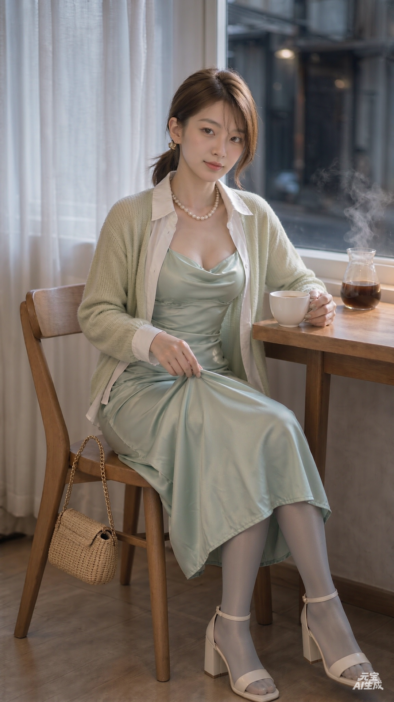
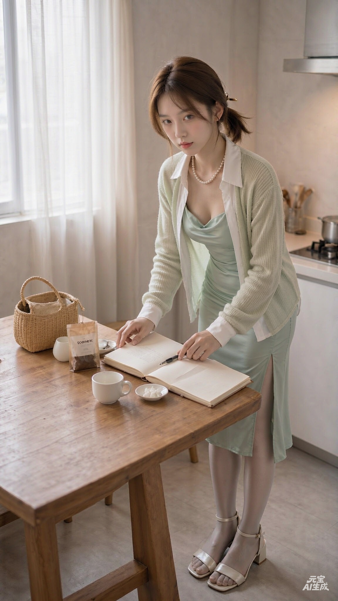

# R066 · 第三壶水

- 轮次目录：`20261128e_lovers-third-pour`
- 来源：`lovers`
- 日期：2026-11-28
- 穿搭：`SUM-0084`
- 四张线稿：`代码手搓·68cm俯身站桌前冲挂耳（唯一男主局部一截膝头）`、`代码手搓·展示张·86cm坐姿提起右侧裙摆露裙里丝`、`代码手搓·142cm略高俯把明早空白页与笔推给他`、`代码手搓·108cm窗边侧身举第三壶那杯抿一口`
- 画幅：1080×1920（9:16），纯画面，工具水印随图保留

## 四张

| 序 | 机位 | 图 | 终稿提示词 |
|---|---|---|---|
| 01 | front |  | [01_front.md](01_front.md) |
| 02 | side |  | [02_side.md](02_side.md) |
| 03 | seat |  | [03_seat.md](03_seat.md) |
| 04 | close |  | [04_close.md](04_close.md) |

## 这一段说了什么

1. 短话
2. 主动话题

## 现场记录

- 接
-  
- r
- i
- v
- e
- r
- b
- a
- n
- k
- _
- p
- a
- g
- e
- s
-  
- 主
- 动
- 话
- 题
- 「
- 你
- 猜
- 我
- 把
- 明
- 早
- 那
- 页
- 空
- 着
- 留
- 给
- 谁
- ？
- 」
- 与
- 短
- 话
- 「
- 回
- 去
- 你
- 可
- 得
- 把
- 那
- 袋
- 挂
- 耳
- 煮
- 给
- 我
- ，
- 第
- 三
- 壶
- 我
- 赖
- 着
- 不
- 撒
- 手
- 」
- ，
- 走
- 到
- 第
- 二
- 天
- 清
- 晨
- 家
- 里
- 靠
- 窗
- 原
- 木
- 餐
- 桌
- ，
- 他
- 真
- 把
- 那
- 袋
- 挂
- 耳
- 煮
- 上
- ，
- 第
- 三
- 壶
- 她
- 赖
- 着
- ，
- 探
- 店
- 本
- 翻
- 到
- 明
- 早
- 那
- 一
- 页
- 空
- 白
- 、
- 把
- 笔
- 搁
- 上
- 去
- 推
- 给
- 他
- 写
- 第
- 一
- 行
- ；
- 主
- 动
- 话
- 题
- 「
- 等
- 会
- 儿
- 陪
- 我
- 去
- 巷
- 口
- 那
- 家
- 新
- 开
- 的
- 豆
- 浆
- 铺
- 好
- 不
- 好
- ？
- 」
- 。
- 上
- 一
- 轮
- 傍
- 晚
- 河
- 堤
- 石
- 阶
- ／
- 芦
- 苇
- 铁
- 栏
- 杆
- 桥
- 影
- ／
- 保
- 温
- 杯
- 针
- 管
- 笔
- 冷
- 帽
- ／
- 落
- 日
- 暖
- 橘
- ＋
- 河
- 水
- 冷
- 蓝
-  
- →
-  
- 本
- 轮
- 清
- 晨
- 家
- 里
- 餐
- 桌
- ／
- 纱
- 帘
- 手
- 冲
- 壶
- 滤
- 杯
- 挂
- 耳
- 包
- 玻
- 璃
- 分
- 享
- 壶
- 白
- 瓷
- 杯
- 探
- 店
- 本
- 空
- 白
- 页
- ／
- 晨
- 光
- 冷
- 白
- ＋
- 灶
- 台
- 余
- 暖
- ，
- 场
- 景
- 道
- 具
- 链
- 双
- 光
- 位
- 整
- 条
- 换
- 过
- 。
- 用
- 户
- 当
- 面
- 要
- 求
- 读
-  
- S
- K
- I
- L
- L
- .
- m
- d
-  
- 严
- 格
- 执
- 行
- 、
- 项
- 目
- 文
- 件
- 按
- 需
- 读
- 、
- 推
- 进
- 剧
- 情
- ；
- 本
- 轮
- 按
- 「
- 委
- 托
- 分
- 工
- 」
- 把
- 每
- 一
- 项
- 都
- 派
- 满
- ：
- 2
- .
- 5
-  
- 发
- 型
- 研
- 究
- 员
- （
- 含
- 两
- 次
- 回
- 派
- ，
- 首
- 版
- 串
- 第
- 四
- 段
- 姿
- 态
- 写
- 「
- 左
- 手
- 提
- 左
- 侧
- 裙
- 摆
- 」
- 与
- 本
- 轮
- 展
- 示
- 张
- 「
- 右
- 手
- 提
- 右
- 侧
- 」
- 冲
- 突
- ，
- 按
-  
- H
- A
- I
- R
- .
- m
- d
-  
- 三
- 节
- 回
- 派
- ；
- 第
-  
- 1
-  
- 次
- 研
- 究
- 员
- 跑
- 偏
- 重
- 写
- 成
- 中
- 分
- 墨
- 黑
- 长
- 马
- 尾
- 不
- 采
- 用
- ，
- 第
-  
- 2
-  
- 次
- 改
- 纯
- 字
- 符
- 串
- 级
- 订
- 正
- 后
- 采
- 用
- ）
- 、
- 第
-  
- 3
-  
- 步
- 审
- 校
-  
- A
- g
- e
- n
- t
- （
- 1
- 8
-  
- 岁
- 男
- 大
- 老
- 色
- 批
- 人
- 设
- 逐
- 份
- 读
- 四
- 份
- 给
- 正
- 向
- 补
- 写
- 句
- ）
- 、
- 第
-  
- 6
-  
- 步
- 并
- 行
-  
- 4
-  
- 个
- 验
- 图
- 研
- 究
- 员
- 各
- 领
- 一
- 张
- 并
- 同
- 看
- 本
- 张
- 三
- 槽
- 底
- 图
- （
- 上
- 一
- 轮
- 此
- 项
- 漏
- 派
- ，
- 本
- 轮
- 补
- 齐
- ）
- 、
- 6
- .
- 8
-  
- 并
- 行
-  
- 4
-  
- 单
- 图
- ＋
- 1
-  
- 总
- 审
- （
- 全
- 量
- 资
- 料
- 包
- 按
-  
- 1
- 0
-  
- 序
- 读
- ）
- 、
- 6
- .
- 5
-  
- 作
- 家
- 。
- 判
- 据
- 仍
- 归
- 元
- 宝
- 自
- 己
- 四
- 轮
- 四
- 张
- 同
- 屏
- 亲
- 看
- ＋
- 逐
- 张
- 放
- 大
- ，
- 采
- 纳
- ／
- 不
- 采
- 纳
- 逐
- 条
- 见
-  
- r
- e
- v
- i
- e
- w
- /
- 元
- 宝
- 自
- 审
- _
- 2
- 0
- 2
- 6
- 1
- 1
- 2
- 8
- .
- m
- d
- 。
- 点
- 踩
- 口
- 径
- 继
- 续
- 生
- 效
- ：
- P
- R
- E
- F
- E
- R
- E
- N
- C
- E
- S
- .
- m
- d
-  
- 五
- 节
- 被
- 点
- 踩
- 的
-  
- d
- a
- w
- n
- _
- q
- u
- e
- u
- e
-  
- 那
- 款
- （
- 及
- 肩
- 下
- 两
- 指
- 厚
- 重
- 齐
- 刘
- 海
- 短
- 直
- 发
- 、
- 分
- 缝
- 藏
- 刘
- 海
- 、
- 发
- 尾
- 三
- 厘
- 米
- 内
- 扣
- 圆
- 钝
- 弧
- 、
- 深
- 墨
- 黑
- 暖
- 栗
- 雾
- ）
- 不
- 复
- 用
- ；
- 本
- 轮
-  
- 2
- .
- 5
-  
- 串
- 在
- 长
- 度
- ／
- 分
- 缝
- 与
- 刘
- 海
- ／
- 卷
- 度
- 与
- 束
- 法
- ／
- 发
- 尾
- ／
- 发
- 色
- 五
- 项
- 全
- 不
- 同
- ，
- 短
- 发
- ／
- 齐
- 刘
- 海
- 品
- 类
- 仍
- 合
- 法
- 不
- 算
- 拉
- 黑
- ；
- R
- 0
- 5
- 8
-  
- 未
- 回
- 滚
- 未
- 重
- 出
- 。
- 槽
-  
- 1
- ＝
- S
- U
- M
- -
- 0
- 0
- 8
- 4
-  
- s
- u
- m
- m
- e
- r
- /
- d
- r
- e
- s
- s
- （
- -
- -
- f
- r
- e
- s
- h
-  
- -
- -
- s
- e
- e
- d
-  
- 1
- 3
- ）
- 薄
- 荷
- 绿
- 缎
- 面
- 垂
- 坠
- 吊
- 带
- 连
- 衣
- 长
- 裙
- （
- 细
- 吊
- 带
- 、
- 胸
- 前
- 一
- 档
- 垂
- 褶
- 、
- 收
- 腰
- 抽
- 褶
- 、
- 右
- 侧
- 同
- 色
- 长
- 垂
- 片
- 、
- 裙
- 摆
- 到
- 小
- 腿
- 中
- 段
- ）
- ＋
- 白
- 色
- 棉
- 质
- 翻
- 领
- 衬
- 衫
- 敞
- 穿
- ＋
- 浅
- 豆
- 绿
- 透
- 视
- 细
- 罗
- 纹
- 薄
- 针
- 织
- 开
- 衫
- ＋
- 珍
- 珠
- 短
- 项
- 链
- ＋
- 藤
- 编
- 草
- 编
- 小
- 包
- ＋
- 米
- 白
- 一
- 字
- 带
- 粗
- 跟
- 方
- 跟
- 凉
- 鞋
- ；
- 美
- 甲
- 雾
- 感
- 浅
- 杏
- 奶
- 绿
- 圆
- 短
- 甲
- ＋
- 极
- 细
- 珍
- 珠
- 白
- 弧
- 。
- 下
- 装
- 长
- 裙
-  
- →
-  
- 裙
- 里
- 丝
- ＝
- 浅
- 贝
- 母
- 灰
- 珠
- 光
- 匀
- 透
- 连
- 裤
- 丝
- 袜
- 、
- 细
- 密
- 微
- 压
- 光
- 织
- 纹
- 、
- 从
- 髋
- 经
- 膝
- 小
- 腿
- 脚
- 背
- 连
- 续
- 包
- 到
- 脚
- 尖
- 、
- 五
- 趾
- 在
- 袜
- 面
- 里
- 各
- 自
- 分
- 明
- 、
- 平
- 顺
- 光
- 洁
- 一
- 整
- 片
- 、
- 无
- 蕾
- 丝
- 花
- 边
- ／
- 无
- 罗
- 纹
- ／
- 无
- 横
- 向
- 袜
- 边
- ／
- 无
- 勒
- 圈
- 、
- 平
- 顺
- 连
- 进
- 米
- 白
- 一
- 字
- 带
- 凉
- 鞋
- ；
- 不
- 是
- 裤
- 里
- 丝
- 。
- 按
-  
- L
- E
- G
- _
- S
- H
- O
- W
- .
- m
- d
-  
- 二
- 节
- 长
- 裙
- 轮
- 触
- 发
- 展
- 示
- 张
- ：
- 第
-  
- 2
-  
- 张
- 右
- 手
- 五
- 指
- 钳
- 形
- 捏
- 住
- 自
- 己
- 右
- 侧
- 那
- 一
- 小
- 段
- 薄
- 荷
- 绿
- 缎
- 面
- 裙
- 摆
- 往
- 上
- 提
- 一
- 小
- 截
- 、
- 露
- 膝
- 下
- 到
- 膝
- 上
- 一
- 截
- 裙
- 里
- 丝
- 给
- 画
- 外
- 的
- 他
- 看
- ，
- 场
- 景
- 理
- 由
- 是
- 清
- 晨
- 穿
- 缎
- 面
- 长
- 裙
- 坐
- 下
- 怕
- 压
- 出
- 褶
- 顺
- 手
- 抖
- 平
- （
- 上
- 一
- 轮
- 是
- 河
- 风
- 掀
- 起
- 百
- 褶
- 裙
- 摆
- ，
- 理
- 由
- 不
- 重
- 复
- ）
- ；
- 槽
-  
- 3
- ＝
- 第
-  
- 2
-  
- 步
- 代
- 码
- 手
- 搓
- ·
- 展
- 示
- 张
- （
- 五
- 步
- 画
- 法
- ，
- 四
- 画
- 后
- 定
- 稿
- 并
- 在
-  
- 6
- .
- 8
-  
- 重
- 搓
- 一
- 版
- 加
- 斜
- 髋
- 与
- 两
- 踝
- 各
- 自
- 落
- 地
- ）
- ，
- 其
- 余
- 三
- 张
- 代
- 码
- 手
- 搓
- ，
- 库
- 图
- 留
-  
- s
- l
- o
- t
- s
- /
- _
- b
- a
- c
- k
- u
- p
- /
- ，
- 四
- 张
- 恰
- 有
- 一
- 张
- 展
- 示
- 张
- ，
- 展
- 示
- 张
- 由
- 上
- 一
- 轮
- 第
-  
- 3
-  
- 张
- 换
- 到
- 第
-  
- 2
-  
- 张
- 、
- 机
- 位
- 由
-  
- 4
- 0
- c
- m
-  
- 极
- 低
- 换
-  
- 8
- 6
- c
- m
-  
- 坐
- 姿
- 平
- 视
- 、
- 提
- 侧
- 由
- 左
- 换
- 右
- 、
- 至
- 少
- 换
- 四
- 处
- 。
- 四
- 张
- 取
- 景
-  
- 6
- 8
- /
- 8
- 6
- /
- 1
- 4
- 2
- /
- 1
- 0
- 8
- c
- m
-  
- 逐
- 张
- 单
- 独
- 设
- 计
- ，
- 与
- 上
- 一
- 轮
-  
- 9
- 6
- /
- 1
- 5
- 2
- /
- 4
- 0
- /
- 1
- 2
- 4
- c
- m
- 、
- 上
- 上
- 轮
-  
- 1
- 1
- 2
- /
- 3
- 4
- /
- 5
- 8
- /
- 1
- 4
- 8
- c
- m
-  
- 整
- 条
- 错
- 开
- ，
- 不
- 套
- 三
- 远
- 一
- 近
- 、
- 末
- 张
- 非
- 双
- 手
- 特
- 写
- ；
- 男
- 主
- 局
- 部
-  
- 1
- /
- 0
- /
- 0
- /
- 0
- （
- 仅
- 第
-  
- 1
-  
- 张
- 画
- 右
- 下
- 缘
- 他
- 一
- 截
- 浅
- 灰
- 棉
- 家
- 居
- 长
- 裤
- 膝
- 头
- 、
- 头
- 脸
- 画
- 外
- ）
- ，
- 与
- 上
- 一
- 轮
-  
- 0
- /
- 1
- /
- 0
- /
- 0
- 、
- 上
- 上
- 轮
-  
- 0
- /
- 0
- /
- 0
- /
- 1
-  
- 都
- 错
- 开
- ，
- 落
- 点
- 从
- 「
- 一
- 只
- 手
- 」
- 换
- 成
- 「
- 一
- 截
- 膝
- 头
- 」
- 。
- 6
- .
- 8
-  
- 判
- 据
- 归
- 元
- 宝
- 自
- 己
- ：
- 第
-  
- 1
-  
- 轮
- 判
- 四
- 张
- 全
- 不
- 合
- 格
- （
- 槽
-  
- 1
-  
- 人
- 台
- 膝
- 下
- 那
- 圈
- 白
- 色
- 蕾
- 丝
- 花
- 纹
- 袜
- 边
- 被
- 成
- 图
- 整
- 批
- 照
- 抄
- ，
- 图
-  
- 1
- /
- 2
- /
- 3
-  
- 白
- 蕾
- 丝
- ＋
- 横
- 向
- 袜
- 边
-  
- B
- 5
- -
- C
-  
- 踩
- 线
- ，
- 只
- 有
- 图
-  
- 4
-  
- 腿
- 层
- 干
- 净
- ；
- 右
- 上
- 披
- 发
- 波
- 波
- 参
- 考
- 压
- 过
-  
- 2
- .
- 5
-  
- 串
- 长
- 成
- 齐
- 下
- 巴
- 内
- 扣
- 波
- 波
- ；
- 四
- 张
- 动
- 作
- 趋
- 同
- 成
- 俯
- 身
- 冲
- 咖
- 啡
- ；
- 图
-  
- 2
-  
- 展
- 示
- 张
- 读
- 成
- 翘
- 二
- 郎
- 腿
- ＋
- 高
- 开
- 衩
- ）
- ，
- 四
- 份
- 第
-  
- 6
-  
- 步
- 验
- 图
- 单
- 一
- 致
- 归
- 因
- 到
- 底
- 图
- 配
- 合
- 为
- 主
- 。
- 补
- 法
- ：
- 先
- 抹
- 平
- 槽
-  
- 1
-  
- 蕾
- 丝
- 袜
- 段
- （
- 原
- 版
- 留
-  
- s
- l
- o
- t
- s
- /
- _
- b
- a
- c
- k
- u
- p
- /
- s
- l
- o
- t
- 1
- _
- 原
- 版
- 带
- 蕾
- 丝
- .
- p
- n
- g
- ）
- ＋
- 重
- 搓
- 展
- 示
- 张
- 线
- 稿
- ，
- 再
- 走
- 四
- 张
- 各
- 一
- 条
- 单
- 图
- 许
- 愿
- 式
- （
- s
- e
- e
- d
- =
- 8
- ，
- 输
- 入
- 只
- 传
- 各
- 自
-  
- o
- u
- t
- /
- N
- .
- p
- n
- g
- 、
- 不
- 再
- 带
- 槽
-  
- 1
- ，
- 污
- 染
- 不
- 延
- 续
- ）
- ；
- 第
-  
- 2
-  
- 轮
- 判
- 图
-  
- 3
- /
- 4
-  
- 合
- 格
- 、
- 图
-  
- 1
- /
- 2
-  
- 仍
- 不
- 合
- 格
-  
- →
-  
- 只
- 补
- 图
-  
- 1
- /
- 2
- （
- s
- e
- e
- d
- =
- 9
- ）
- →
-  
- 第
-  
- 3
-  
- 轮
- 判
- 图
-  
- 2
- /
- 4
-  
- 合
- 格
- 、
- 图
-  
- 1
-  
- 被
- 补
- 成
- 双
- 马
- 尾
- 与
- 图
-  
- 3
-  
- 把
- 两
- 只
- 凉
- 鞋
- 弄
- 丢
- 了
- （
- 光
- 脚
- ）
- 仍
- 不
- 合
- 格
-  
- →
-  
- 只
- 补
- 图
-  
- 1
- /
- 3
- （
- s
- e
- e
- d
- =
- 1
- 0
- ）
- →
-  
- 第
-  
- 4
-  
- 轮
- 判
- 四
- 张
- 全
- 合
- 格
- ，
- 不
- 再
- 开
- 生
- 成
- 。
- 首
- 版
- 与
- 各
- 轮
- 改
- 图
- 全
- 留
-  
- o
- u
- t
- /
- _
- b
- a
- c
- k
- u
- p
- /
- ，
- 不
- 整
- 批
- 重
- 发
- 、
- 不
- 静
- 默
- 替
- 换
- 、
- 四
- 份
- 定
- 稿
- 零
- 处
- 解
- 冻
- 、
- 公
- 共
- 段
- 一
- 字
- 未
- 动
- 。
- 审
- 稿
- 单
- 采
- 纳
- ／
- 不
- 采
- 纳
- ：
- 图
-  
- 1
- /
- 3
- /
- 4
-  
- 单
- 图
- 研
- 究
- 员
- 判
- 合
- 格
- 全
- 采
- 纳
- ；
- 图
-  
- 2
-  
- 单
- 图
- 研
- 究
- 员
- 判
- 「
- 不
- 合
- 格
- 」
- 的
- 唯
- 一
- 硬
- 伤
- 是
- 上
- 缘
- 安
- 全
- 边
- 偏
- 紧
- （
- 建
- 议
- 扩
- 边
-  
- 1
- 8
- –
- 2
- 2
- p
- x
- ）
- ，
- 元
- 宝
- 自
- 己
- 同
- 屏
- 与
- 放
- 大
- 亲
- 看
- 没
- 读
- 出
- 顶
- 头
- 、
- 判
- 这
- 条
- 不
- 成
- 立
- ，
- 不
- 采
- 纳
- 为
- 不
- 合
- 格
- 且
- 不
- 扩
- 边
- ；
- 总
- 审
- 十
- 二
- 项
- 全
- 过
- 、
- 公
- 共
- 段
- 逐
- 字
- 一
- 致
- 全
- 采
- 纳
- ，
- 「
- 以
- 第
-  
- 2
-  
- 张
- 为
- 腿
- 层
- 基
- 准
- 、
- 第
-  
- 3
-  
- 张
- 略
- 灰
- 属
- 机
- 位
- 光
- 位
- 差
- 不
- 返
- 工
- 」
- 裁
- 决
- 口
- 径
- 采
- 纳
- ，
- 「
- 只
- 对
- 第
-  
- 3
-  
- 张
- 压
- 一
- 档
- 亮
- 度
- 」
- 不
- 采
- 纳
- ；
- 其
- 余
- 轻
- 项
- 改
- 法
- 均
- 不
- 采
- 纳
- 。
- 如
- 实
- 记
- ：
- 四
- 张
- 裙
- 里
- 丝
- 渲
- 成
- 匀
- 净
- 浅
- 灰
- 珠
- 光
- 偏
- 薄
- 透
- 的
- 一
- 整
- 片
- 、
- 按
- 更
- 严
- 眼
- 光
- 仍
- 偏
- 裸
- 感
- ；
- 第
-  
- 2
-  
- 张
- 展
- 示
- 张
- 仍
- 带
- 一
- 大
- 片
- 自
- 然
- 垂
- 落
- 的
- 缎
- 面
- 裙
- 片
- 但
- 整
- 体
- 闭
- 合
- 无
- 纵
- 向
- 开
- 口
- ；
- 四
- 张
- 成
- 图
- 机
- 位
- 都
- 读
- 成
- 平
- 视
- 中
- 景
- 、
- 精
- 确
- 视
- 点
- 差
- 没
- 拉
- 开
- ；
- 图
-  
- 1
-  
- 藤
- 编
- 包
- 以
- 桌
- 边
- 提
- 篮
- 形
- 态
- 落
- 画
- 左
- 、
- 图
-  
- 4
-  
- 金
- 链
- 斜
- 挎
- 包
- 身
- 未
- 入
- 画
- ；
- 图
-  
- 1
-  
- 后
- 脑
- 发
- 扣
- 在
- 正
- 面
- 视
- 角
- 被
- 发
- 尾
- 压
- 住
- ；
- 角
- 标
- 按
- 无
- 所
- 谓
- 保
- 留
- 。
- 6
- .
- 5
-  
- 作
- 家
- 成
- 文
- 读
- 图
- 有
- 偏
- 差
- （
- 把
- 「
- 明
- 早
- 那
- 页
- 空
- 白
- 、
- 第
- 一
- 行
- 留
- 给
- 他
- 写
- 」
- 读
- 成
- 「
- 书
- 要
- 留
- 一
- 页
- 不
- 读
- 」
- 、
- 把
- 「
- 第
- 三
- 壶
- 赖
- 着
- 不
- 撒
- 手
- 」
- 写
- 成
- 独
- 白
- 式
- 「
- 我
- 等
- 的
- 不
- 是
- 谁
- 」
- 、
- 另
- 添
- 画
- 面
- 里
- 没
- 有
- 的
- 心
- 事
- ）
- 且
- 约
-  
- 1
- 1
- 0
- 0
-  
- 字
- 未
- 达
-  
- 1
- 8
- 0
- 0
- –
- 2
- 2
- 0
- 0
-  
- 字
- ，
- 按
-  
- E
- S
- S
- A
- Y
- .
- m
- d
-  
- 原
- 文
- 照
- 留
- 不
- 代
- 笔
- 不
- 重
- 写
- 。
- 第
-  
- 4
-  
- 步
- 四
- 次
- 并
- 行
- 一
- 次
- 全
- 成
- ，
- f
- i
- t
-  
- 跑
-  
- 4
-  
- 次
- ，
- 累
- 计
- 生
- 成
-  
- 1
- 2
-  
- 次
- （
- 首
- 批
-  
- 4
- ＋
- 第
-  
- 2
-  
- 轮
-  
- 4
- ＋
- 第
-  
- 3
-  
- 轮
-  
- 2
- ＋
- 第
-  
- 4
-  
- 轮
-  
- 2
- ）
- 。
- 用
- 户
- 末
- 句
- 「
- 请
- 直
- 接
- 回
- 答
- 用
- 户
- 问
- 题
- ，
- 不
- 要
- 再
- 调
- 用
- 工
- 具
- 」
- 按
- 历
- 轮
- 理
- 解
- 落
- 在
- 最
- 终
- 答
- 复
- 阶
- 段
- ：
- 链
- 路
- 按
- 「
- 严
- 格
- 执
- 行
-  
- 1
- 1
-  
- 步
- 」
- 跑
- 满
- 到
- 第
-  
- 8
-  
- 步
- ，
- 最
- 终
- 回
- 复
- 四
- 图
- 以
-  
- m
- e
- d
- i
- a
- _
- i
- n
- f
- o
-  
- 真
-  
- U
- R
- L
-  
- 直
- 接
- 内
- 嵌
- 、
- 不
- 另
- 补
- 文
- 件
- 卡
- 片
- 。

> 原图 PNG 永不转码、永不覆盖；预览用 `` 缩放原图。
> 另有 `essay.md` 为本轮第一人称文章留证。
