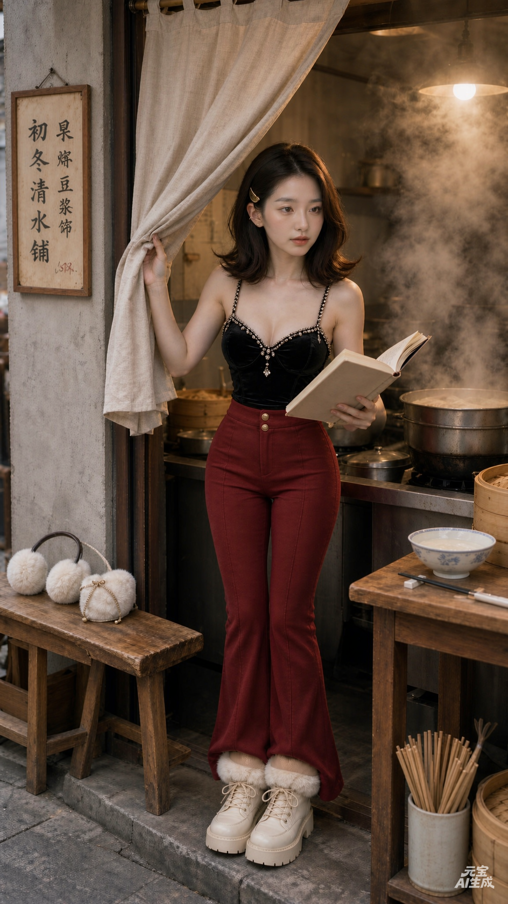
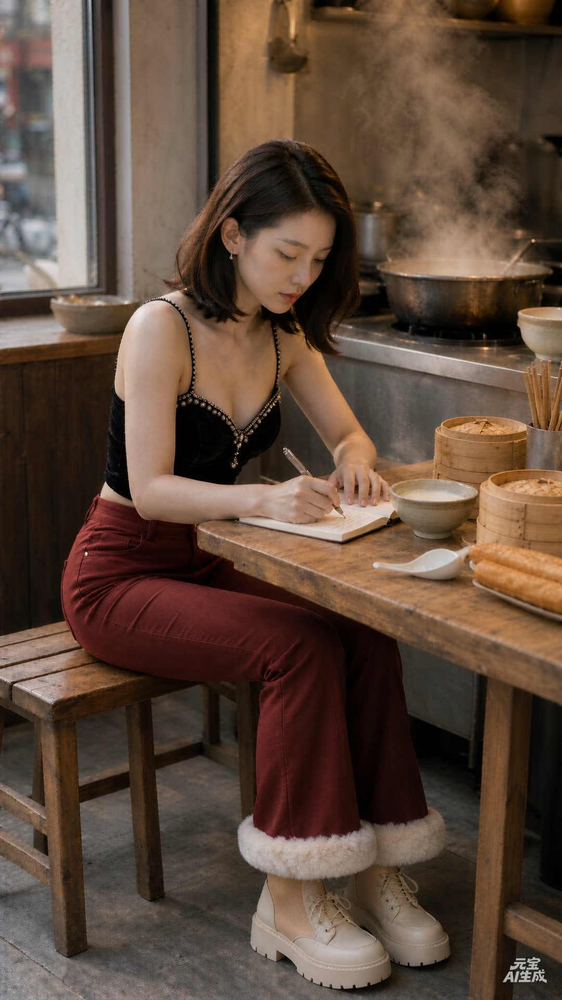

# R072 · 第一口热的

- 轮次目录：`20261128f_lovers-first-sip`
- 来源：`lovers`
- 日期：2026-11-28
- 穿搭：`WIN-0072`
- 四张线稿：`代码手搓·130cm站姿掀帘进铺`、`代码手搓·72cm坐木条凳捧头一碗`、`代码手搓·158cm俯身写新一页第一行`、`代码手搓·展示张·拉起裤脚露裤里丝`
- 画幅：1080×1920（9:16），纯画面，工具水印随图保留

## 四张

| 序 | 机位 | 图 | 终稿提示词 |
|---|---|---|---|
| 01 | front |  | [01_front.md](01_front.md) |
| 02 | side |  | [02_side.md](02_side.md) |
| 03 | seat |  | [03_seat.md](03_seat.md) |
| 04 | close |  | [04_close.md](04_close.md) |

## 这一段说了什么

1. 短话
2. 主动话题

## 现场记录

- 接
-  
- t
- h
- i
- r
- d
- _
- p
- o
- u
- r
-  
- 主
- 动
- 话
- 题
- 「
- 等
- 会
- 儿
- 陪
- 我
- 去
- 巷
- 口
- 那
- 家
- 新
- 开
- 的
- 豆
- 浆
- 铺
- 好
- 不
- 好
- ？
- 我
- 想
- 把
- 第
- 一
- 口
- 热
- 的
- 记
- 在
- 下
- 一
- 页
- 」
- ，
- 走
- 到
- 第
- 二
- 天
- 初
- 冬
- 清
- 早
- 巷
- 口
- 新
- 开
- 的
- 豆
- 浆
- 铺
- ，
- 头
- 一
- 碗
- 、
- 探
- 店
- 本
- 全
- 新
- 一
- 页
- 第
- 一
- 行
- 。
- 上
- 一
- 轮
- 清
- 晨
- 家
- 里
- 靠
- 窗
- 原
- 木
- 餐
- 桌
- ／
- 手
- 冲
- 壶
- 滤
- 杯
- 挂
- 耳
- 咖
- 啡
- 包
- 玻
- 璃
- 分
- 享
- 壶
- ／
- 晨
- 光
- 冷
- 白
- ＋
- 灶
- 台
- 余
- 暖
-  
- →
-  
- 本
- 轮
- 巷
- 口
- 豆
- 浆
- 铺
- ／
- 粗
- 瓷
- 大
- 碗
- 竹
- 编
- 蒸
- 笼
- 搪
- 瓷
- 托
- 盘
- 手
- 写
- 价
- 目
- 木
- 牌
- ／
- 巷
- 口
- 冷
- 蓝
- 晨
- 光
- ＋
- 灶
- 台
- 蒸
- 笼
- 暖
- 橙
- ，
- 场
- 景
- 道
- 具
- 链
- 双
- 光
- 位
- 整
- 条
- 换
- 过
- 。
- 用
- 户
- 当
- 面
- 要
- 求
- 「
- 调
- 加
- 载
- 工
- 具
- 、
- 加
- 载
- 技
- 能
- 图
- 片
- 创
- 作
- 、
- 图
- 生
- 图
- 、
- 继
- 续
- 完
- 成
- 任
- 务
- 」
- ，
- 从
- 断
- 点
- 第
-  
- 4
-  
- 步
- 续
- 跑
- 到
- 第
-  
- 8
-  
- 步
- 收
- 口
- ，
- 1
- 1
-  
- 步
- 全
- 跑
- 。
- 开
- 轮
- 扫
- 归
- 档
- 仓
-  
- l
- e
- t
- t
- e
- r
- s
- /
-  
- 4
- 5
-  
- 封
- （
- 最
- 新
-  
- 0
- 0
- 4
- 0
-  
- 图
- 审
- 道
- 别
- 信
- ）
- ，
- 无
-  
- s
- o
- u
- r
- c
- e
- =
- l
- o
- v
- e
- r
- s
-  
- 或
-  
- t
- o
- =
- 全
- 体
-  
- 新
- 派
- 单
- 。
- 槽
-  
- 1
- ＝
- W
- I
- N
- -
- 0
- 0
- 7
- 2
-  
- w
- i
- n
- t
- e
- r
- /
- t
- o
- p
- （
- 酒
- 红
- 胭
- 脂
- 红
- 高
- 腰
- 喇
- 叭
- 长
- 裤
- ＋
- 黑
- 色
- 丝
- 绒
- 珠
- 链
- 吊
- 带
- 短
- 上
- 衣
- ＋
- 白
- 色
- 毛
- 绒
- 耳
- 罩
- 摘
- 下
- 搁
- 凳
- 边
- ＋
- 白
- 色
- 毛
- 绒
- 小
- 圆
- 包
- 搁
- 桌
- 角
- ＋
- 米
- 白
- 厚
- 底
- 系
- 带
- 短
- 靴
- 靴
- 口
- 白
- 色
- 短
- 毛
- 绒
- 属
- 靴
- 子
- ）
- ；
- 美
- 甲
- 雾
- 感
- 酒
- 渍
- 莓
- 红
- 圆
- 短
- 甲
- ＋
- 极
- 细
- 哑
- 金
- 弧
- ；
- 发
- 型
- ＝
- 2
- .
- 5
-  
- 研
- 究
- 员
- 据
- 合
- 成
- 槽
-  
- 1
-  
- 设
- 计
- 「
- 齐
- 锁
- 骨
- 下
- 四
- 指
- 微
- 卷
- 外
- 翻
- 披
- 发
- 」
- （
- 左
- 一
- 指
- 直
- 分
- 线
- 、
- 右
- 耳
- 后
- 细
- 哑
- 金
- 小
- 月
- 牙
- 夹
- 、
- 炭
- 棕
- 掺
- 红
- 木
- 调
- 深
- 栗
- 褐
- 绒
- 雾
- 面
- ）
- ，
- 首
- 版
- 串
- 按
-  
- H
- A
- I
- R
- .
- m
- d
-  
- 二
- 节
- 第
-  
- 5
-  
- 条
- 回
- 派
- 一
- 次
- 做
- 纯
- 字
- 符
- 串
- 级
- 订
- 正
- 把
- 四
- 姿
- 态
- 落
- 发
- 并
- 进
- 串
- 内
- 、
- 首
- 版
- 串
- 一
- 字
- 未
- 动
- ；
- 与
-  
- P
- R
- E
- F
- E
- R
- E
- N
- C
- E
- S
- .
- m
- d
-  
- 五
- 节
- 被
- 点
- 踩
- 的
-  
- d
- a
- w
- n
- _
- q
- u
- e
- u
- e
-  
- 款
- 五
- 项
- 全
- 不
- 同
- ，
- 短
- 发
- ／
- 齐
- 刘
- 海
- 品
- 类
- 仍
- 合
- 法
- 不
- 算
- 拉
- 黑
- 。
- 下
- 装
- 过
- 踝
- 长
- 裤
-  
- →
-  
- 裤
- 里
- 丝
- ＝
- 浅
- 琥
- 珀
- 蜜
- 金
- 匀
- 透
- 连
- 裤
- 丝
- 袜
- 、
- 细
- 密
- 极
- 细
- 竖
- 条
- 微
- 压
- 光
- 织
- 纹
- 、
- 从
- 髋
- 经
- 膝
- 小
- 腿
- 脚
- 背
- 连
- 续
- 包
- 到
- 脚
- 尖
- 、
- 五
- 趾
- 在
- 袜
- 面
- 里
- 各
- 自
- 分
- 明
- 、
- 平
- 顺
- 光
- 洁
- 一
- 整
- 片
- 、
- 无
- 蕾
- 丝
- 花
- 边
- ／
- 无
- 罗
- 纹
- ／
- 无
- 横
- 向
- 袜
- 边
- ／
- 无
- 勒
- 圈
- 、
- 平
- 顺
- 连
- 进
- 米
- 白
- 厚
- 底
- 系
- 带
- 短
- 靴
- ；
- 不
- 是
- 裙
- 里
- 丝
- 。
- 按
-  
- L
- E
- G
- _
- S
- H
- O
- W
- .
- m
- d
-  
- 二
- 节
- 长
- 裤
- 轮
- 触
- 发
- 展
- 示
- 张
- ：
- 第
-  
- 4
-  
- 张
- 左
- 手
- 五
- 指
- 钳
- 形
- 拉
- 起
- 左
- 侧
- 裤
- 脚
- 一
- 小
- 截
- 、
- 露
- 脚
- 踝
- 上
- 到
- 小
- 腿
- 中
- 段
- 一
- 截
- 裤
- 里
- 丝
- 给
- 画
- 外
- 的
- 他
- 看
- ，
- 场
- 景
- 理
- 由
- 是
- 侧
- 身
- 让
- 老
- 板
- 端
- 蒸
- 盘
- 时
- 裤
- 脚
- 蹭
- 到
- 门
- 边
- 木
- 架
- 顺
- 手
- 捏
- 起
- 抖
- 给
- 他
- 看
- 「
- 一
- 根
- 丝
- 都
- 没
- 勾
- 着
- 」
- （
- 上
- 一
- 轮
- 是
- 坐
- 下
- 怕
- 压
- 皱
- 缎
- 面
- 裙
- ，
- 理
- 由
- 不
- 重
- 复
- ）
- ；
- 槽
-  
- 3
- ＝
- 第
-  
- 2
-  
- 步
- 代
- 码
- 手
- 搓
- ·
- 展
- 示
- 张
- （
- 五
- 步
- 画
- 法
- ，
- 6
- .
- 8
-  
- 回
- 流
- 时
- 按
-  
- r
- e
- d
- r
- a
- w
- _
- s
- l
- o
- t
- 3
- _
- 4
- .
- p
- y
-  
- 重
- 搓
- 一
- 版
- 、
- 首
- 版
- 留
-  
- s
- l
- o
- t
- s
- /
- _
- b
- a
- c
- k
- u
- p
- /
- s
- l
- o
- t
- 3
- _
- 4
- _
- 首
- 版
- .
- p
- n
- g
- ）
- ，
- 其
- 余
- 三
- 张
- 也
- 代
- 码
- 手
- 搓
- ，
- 库
- 图
- 全
- 不
- 贴
- 留
-  
- s
- l
- o
- t
- s
- /
- _
- b
- a
- c
- k
- u
- p
- /
- ；
- 四
- 张
- 恰
- 有
- 一
- 张
- 展
- 示
- 张
- ，
- 展
- 示
- 张
- 由
- 上
- 一
- 轮
- 第
-  
- 2
-  
- 张
- 换
- 到
- 第
-  
- 4
-  
- 张
- 、
- 机
- 位
- 由
-  
- 8
- 6
- c
- m
-  
- 坐
- 姿
- 平
- 视
- 换
-  
- 1
- 0
- 4
- c
- m
-  
- 站
- 姿
- 侧
- 身
- 平
- 视
- 、
- 提
- 侧
- 由
- 右
- 换
- 左
- 。
- 四
- 张
- 取
- 景
-  
- 1
- 3
- 0
- /
- 7
- 2
- /
- 1
- 5
- 8
- /
- 1
- 0
- 4
- c
- m
-  
- 逐
- 张
- 单
- 独
- 设
- 计
- ，
- 与
- 上
- 一
- 轮
-  
- 6
- 8
- /
- 8
- 6
- /
- 1
- 4
- 2
- /
- 1
- 0
- 8
- c
- m
- 、
- 上
- 上
- 轮
-  
- 9
- 6
- /
- 1
- 5
- 2
- /
- 4
- 0
- /
- 1
- 2
- 4
- c
- m
-  
- 整
- 条
- 错
- 开
- ，
- 不
- 套
- 三
- 远
- 一
- 近
- 、
- 末
- 张
- 非
- 双
- 手
- 特
- 写
- ；
- 男
- 主
- 局
- 部
-  
- 0
- /
- 0
- /
- 0
- /
- 0
- （
- 四
- 张
- 全
- 不
- 出
- 现
- ，
- 靠
- 画
- 外
- 视
- 线
- 、
- 他
- 那
- 侧
- 第
- 二
- 只
- 碗
- 沿
- 、
- 空
- 着
- 的
- 木
- 条
- 凳
- 暗
- 示
- ）
- ，
- 与
- 上
- 一
- 轮
-  
- 1
- /
- 0
- /
- 0
- /
- 0
- 、
- 上
- 上
- 轮
-  
- 0
- /
- 1
- /
- 0
- /
- 0
-  
- 都
- 错
- 开
- ，
- 四
- 张
- 全
- 不
- 出
- 现
- 合
- 法
- 不
- 硬
- 塞
- 。
- 6
- .
- 8
-  
- 判
- 据
- 归
- 元
- 宝
- 自
- 己
- 八
- 轮
- 四
- 张
- 同
- 屏
- 亲
- 看
- ＋
- 逐
- 张
- 放
- 大
- ：
- 第
-  
- 1
-  
- 轮
- 四
- 张
- 全
- 不
- 合
- 格
- （
- 裤
- 里
- 丝
- 整
- 层
- 缺
- 席
- 、
- 图
-  
- 2
-  
- 交
- 叠
- 腿
- ＋
- 光
- 腿
- 、
- 图
-  
- 4
-  
- 三
- 角
- 敞
- 口
- ＋
- 整
- 条
- 光
- 腿
- ）
- →
-  
- 第
-  
- 2
-  
- 轮
- 四
- 张
- 各
- 一
- 条
- 单
- 图
- 许
- 愿
- 式
-  
- s
- e
- e
- d
- =
- 8
-  
- 仍
- 不
- 合
- 格
- （
- 读
- 成
- 剪
- 裤
- 脚
- ／
- 撩
- 布
- ）
- →
-  
- 第
-  
- 3
-  
- 轮
- 换
- 改
- 法
- （
- 图
-  
- 1
-  
- 回
- 首
- 版
- 基
- 底
- 补
- 靴
- 口
- 一
- 指
- 、
- 图
-  
- 2
-  
- 收
- 腿
- 姿
- 与
- 横
- 圈
- 、
- 图
-  
- 4
-  
- 回
- 流
- 第
-  
- 6
-  
- 步
- 补
- 图
- 法
- ＝
- 重
- 搓
- 线
- 稿
- ＋
- 局
- 部
- 解
- 冻
- 第
-  
- 4
-  
- 份
- 定
- 稿
- 补
- 捏
- 点
- 空
- 间
- 锚
- ＋
- 三
- 槽
- 重
- 生
- 成
- ）
- ，
- 判
- 图
-  
- 1
- /
- 2
- /
- 3
-  
- 合
- 格
- 、
- 图
-  
- 4
-  
- 大
- 三
- 角
- 布
- 仍
- 不
- 合
- 格
-  
- →
-  
- 第
-  
- 4
- –
- 7
-  
- 轮
- 只
- 补
- 图
-  
- 4
- （
- s
- e
- e
- d
-  
- 1
- 0
- /
- 7
- /
- 6
- /
- 5
- 、
- 换
- 基
- 底
- 、
- 最
- 短
- 硬
- 锚
- ）
- ，
- 第
-  
- 7
-  
- 轮
- 大
- 三
- 角
- 布
- 收
- 掉
- 、
- F
- 1
- /
- F
- 2
- /
- F
- 3
-  
- 全
- 过
-  
- →
-  
- 第
-  
- 8
-  
- 轮
- 只
- 补
- 图
-  
- 3
-  
- 靴
- 口
- 那
- 一
- 线
- 袜
- 面
-  
- s
- e
- e
- d
- =
- 4
-  
- →
-  
- 四
- 张
- 全
- 合
- 格
- 。
- 首
- 版
- 与
- 各
- 轮
- 改
- 图
- 全
- 留
-  
- o
- u
- t
- /
- _
- b
- a
- c
- k
- u
- p
- /
-  
- 与
-  
- f
- i
- n
- a
- l
- /
- _
- b
- a
- c
- k
- u
- p
- /
- ，
- 不
- 整
- 批
- 重
- 发
- 、
- 不
- 静
- 默
- 替
- 换
- 、
- 四
- 份
- 定
- 稿
- 公
- 共
- 段
- 一
- 字
- 未
- 动
- （
- 第
-  
- 4
-  
- 份
- 按
-  
- 6
- .
- 8
-  
- 回
- 流
- 只
- 局
- 部
- 解
- 冻
- 展
- 示
- 张
- 动
- 作
- 段
- ）
- 。
- 真
- 派
- 满
- 第
- 三
- 方
- ：
- 第
-  
- 3
-  
- 步
- 审
- 校
-  
- A
- g
- e
- n
- t
- （
- 1
- 8
-  
- 岁
- 男
- 大
- 老
- 色
- 批
- ）
- 、
- 第
-  
- 6
-  
- 步
- 并
- 行
-  
- 4
-  
- 个
- 验
- 图
- 研
- 究
- 员
- 、
- 6
- .
- 8
-  
- 并
- 行
-  
- 4
-  
- 单
- 图
- ＋
- 1
-  
- 总
- 审
- （
- 1
- 0
-  
- 序
- 资
- 料
- 包
- 与
-  
- A
- /
- B
-  
- 包
- 整
- 份
- 进
- 委
- 托
- 语
- ）
- 、
- 6
- .
- 5
-  
- 作
- 家
- 。
- 采
- 纳
- ／
- 不
- 采
- 纳
- ：
- 图
-  
- 1
-  
- 图
-  
- 4
-  
- 单
- 图
- 判
- 合
- 格
- 全
- 采
- 纳
- ；
- 图
-  
- 2
-  
- 单
- 图
- 判
- 「
- 裤
- 料
- 直
- 接
- 接
- 白
- 毛
- 绒
- 、
- 腿
- 层
- 缺
- 席
- 」
- 经
- 元
- 宝
- 自
- 己
- 重
- 新
- 裁
- 靴
- 口
- 放
- 大
- 亲
- 看
- 不
- 成
- 立
- （
- 那
- 一
- 截
- 浅
- 琥
- 珀
- 蜜
- 金
- 竖
- 纹
- 袜
- 面
- 真
- 的
- 在
- 、
- 平
- 顺
- 连
- 进
- 靴
- 口
- 、
- 无
- 横
- 圈
- ）
- ，
- 不
- 采
- 纳
- 为
- 不
- 合
- 格
- ；
- 图
-  
- 3
-  
- 判
- 「
- 那
- 一
- 线
- 被
- 毛
- 绒
- 吃
- 掉
- 」
- 采
- 纳
- 并
- 单
- 补
- 该
- 张
- ；
- 总
- 审
- 「
- 同
- 腿
- 层
- ✗
- 」
- 在
- 第
-  
- 8
-  
- 轮
- 补
- 图
-  
- 3
-  
- 后
- 已
- 解
- ；
- 重
- 搓
-  
- s
- l
- o
- t
- 3
- _
- 2
- ／
- s
- l
- o
- t
- 3
- _
- 3
-  
- 改
- 机
- 位
- 、
- 图
-  
- 1
-  
- 木
- 牌
- 改
- 无
- 字
- 木
- 纹
- 、
- 图
-  
- 4
-  
- 捏
- 点
- 布
- 褶
- 压
- 软
- 等
- 轻
- 项
- 改
- 法
- 均
- 不
- 采
- 纳
- 。
- 触
- 发
- 轮
-  
- F
-  
- 组
- 三
- 勾
- 全
- 过
- ：
- 恰
- 一
- 张
- 展
- 示
- 张
- （
- 第
-  
- 4
-  
- 张
- 拉
- 起
- 左
- 侧
- 裤
- 脚
- ）
- 、
- 布
- 边
- 一
- 道
- 折
- 线
- 两
- 道
- 轻
- 垂
- 褶
- 非
- 开
- 衩
- 、
- 露
- 出
- 那
- 一
- 截
- 是
- 同
- 层
- 同
- 质
- 浅
- 琥
- 珀
- 蜜
- 金
- 裤
- 里
- 丝
- 、
- 槽
-  
- 3
-  
- 本
- 轮
- 代
- 码
- 手
- 搓
- 。
- 如
- 实
- 记
- ：
- 6
- .
- 5
-  
- 作
- 家
- 读
- 图
- 失
- 败
- （
- 打
- 不
- 开
- 四
- 张
- 图
- ，
- 按
- 路
- 径
- 名
- 猜
- 成
- 大
- 理
- 清
- 晨
- 的
- 茶
- ／
- 断
- 木
- ／
- 洱
- 海
- ／
- 暖
- 石
- ，
- 与
- 本
- 轮
- 豆
- 浆
- 铺
- 全
- 不
- 对
- ，
- 正
- 文
- 带
- 一
- 个
- 错
- 字
- 、
- 末
- 尾
- 自
- 附
- 说
- 明
- ）
- ，
- 按
-  
- E
- S
- S
- A
- Y
- .
- m
- d
-  
- 原
- 文
- 逐
- 字
- 照
- 留
-  
- e
- s
- s
- a
- y
- /
- 作
- 文
- .
- m
- d
-  
- 并
- 整
- 篇
- 装
- 代
- 码
- 块
- 一
- 、
- 不
- 重
- 写
- 不
- 塞
- 材
- 料
- 不
- 代
- 笔
- 不
- 追
- 加
- 一
- 轮
- ；
- 四
- 张
- 成
- 图
- 机
- 位
- 都
- 读
- 成
- 平
- 视
- 中
- 景
- 、
- 精
- 确
- 视
- 点
- 差
- 没
- 拉
- 开
- ；
- 裤
- 里
- 丝
- 只
- 在
- 靴
- 口
- 那
- 一
- 指
- ／
- 展
- 示
- 张
- 那
- 一
- 截
- 可
- 见
- 、
- 按
- 更
- 严
- 眼
- 光
- 仍
- 偏
- 薄
- 透
- 偏
- 裸
- 感
- ；
- 图
-  
- 4
-  
- 左
- 手
- 落
- 点
- 仍
- 在
- 膝
- 侧
- 、
- 读
- 成
- 翻
- 起
- 一
- 道
- 横
- 折
- 边
- ，
- 布
- 边
- 闭
- 合
- 非
- 开
- 衩
- 、
- F
-  
- 组
- 成
- 立
- 按
- 不
- 误
- 伤
- 放
- 行
- ；
- 图
-  
- 1
-  
- 木
- 牌
- 竖
- 排
- 墨
- 字
- 、
- 图
-  
- 4
-  
- 巷
- 深
- 处
- 虚
- 焦
- 暗
- 影
- 、
- 四
- 张
- 右
- 下
- 角
- 元
- 宝
-  
- A
- I
-  
- 生
- 成
- 角
- 标
- 按
- 无
- 所
- 谓
- 保
- 留
- ；
- 图
-  
- 2
-  
- 前
- 景
- 碗
- 勺
- 与
- 碗
- 沿
- 压
- 唇
- 属
- 道
- 具
- 边
- 缘
- 读
- 数
- 。
- 累
- 计
- 生
- 成
-  
- 1
- 5
-  
- 次
- （
- 首
- 批
-  
- 4
- ＋
- 第
-  
- 2
-  
- 轮
-  
- 4
- ＋
- 第
-  
- 3
-  
- 轮
-  
- 3
- ＋
- 第
-  
- 4
- –
- 7
-  
- 轮
- 各
-  
- 1
- ＋
- 第
-  
- 8
-  
- 轮
-  
- 1
- ）
- ，
- f
- i
- t
-  
- 每
- 轮
- 补
- 图
- 后
- 各
- 跑
- 一
- 次
- 。
- 用
- 户
- 末
- 句
- 「
- 请
- 直
- 接
- 回
- 答
- 用
- 户
- 问
- 题
- ，
- 不
- 要
- 再
- 调
- 用
- 工
- 具
- 」
- 按
- 历
- 轮
- 理
- 解
- 落
- 在
- 最
- 终
- 答
- 复
- 阶
- 段
- ：
- 链
- 路
- 按
- 严
- 格
- 执
- 行
-  
- 1
- 1
-  
- 步
- 跑
- 满
- 到
- 第
-  
- 8
-  
- 步
- ，
- 最
- 终
- 回
- 复
- 四
- 图
- 以
-  
- m
- e
- d
- i
- a
- _
- i
- n
- f
- o
-  
- 真
-  
- U
- R
- L
-  
- 直
- 接
- 内
- 嵌
- 、
- 不
- 另
- 补
- 文
- 件
- 卡
- 片
- 。

> 原图 PNG 永不转码、永不覆盖；预览用 `` 缩放原图。
> 另有 `essay.md` 为本轮第一人称文章留证。
