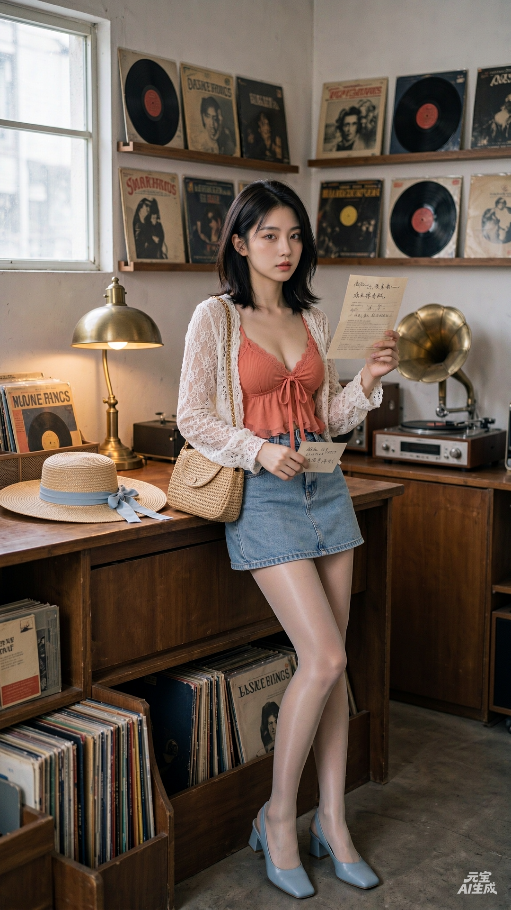

# R078 · 手写歌单

- 轮次目录：`20261128i_lovers-record-shop`
- 来源：`lovers`
- 日期：2026-11-28
- 穿搭：`SUM-0116`
- 四张线稿：`代码手搓·156cm S形站姿顶胯回眸摘帽（唯一男主局部：画右缘他一只手搭玻璃门黄铜门把）`、`代码手搓·58cm 半跪前倾抽黑胶封套抬眼`、`代码手搓·132cm 侧倚柜台举铅笔手写歌单、店卡送回探店本第七页`、`代码手搓·88cm 合本抱胸走近半步别耳后发`
- 画幅：1080×1920（9:16），纯画面，工具水印随图保留

## 四张

| 序 | 机位 | 图 | 终稿提示词 |
|---|---|---|---|
| 01 | front |  | [01_front.md](01_front.md) |
| 02 | side |  | [02_side.md](02_side.md) |
| 03 | seat |  | [03_seat.md](03_seat.md) |
| 04 | close |  | [04_close.md](04_close.md) |

## 这一段说了什么

1. 短话
2. 主动话题

## 现场记录

- 接
-  
- b
- o
- o
- k
- s
- h
- o
- p
- _
- c
- a
- r
- d
-  
- 主
- 动
- 话
- 题
- 「
- 明
- 早
- 那
- 家
- 旧
- 唱
- 片
- 铺
- 开
- 门
- ，
- 陪
- 我
- 把
- 这
- 张
- 店
- 卡
- 夹
- 进
- 第
- 七
- 页
- 、
- 去
- 换
- 一
- 张
- 手
- 写
- 歌
- 单
- 好
- 不
- 好
- ？
- 」
- ，
- 走
- 到
- 初
- 冬
- 清
- 早
- 旧
- 唱
- 片
- 铺
- ：
- 老
- 板
- 照
- 她
- 哼
- 的
- 两
- 句
- 写
- 了
- 张
- 铅
- 笔
- 手
- 写
- 歌
- 单
- ，
- 字
- 比
- 店
- 卡
- 还
- 歪
- ，
- 她
- 把
- 歌
- 单
- 举
- 到
- 铜
- 台
- 灯
- 前
- 看
- 、
- 把
- 昨
- 天
- 那
- 张
- 手
- 写
- 店
- 卡
- 送
- 回
- 探
- 店
- 本
- 第
- 七
- 页
- 。
- 上
- 一
- 轮
- 巷
- 尾
- 旧
- 书
- 铺
- ／
- 玻
- 璃
- 纸
- 压
- 平
- 的
- 薄
- 荷
- 叶
- ／
- 手
- 写
- 店
- 卡
- ／
- 初
- 冬
- 傍
- 晚
-  
- →
-  
- 本
- 轮
- 旧
- 唱
- 片
- 铺
- ／
- 整
- 墙
- 黑
- 胶
- 与
- 木
- 质
- 唱
- 片
- 箱
- ／
- 老
- 式
- 唱
- 机
- 与
- 喇
- 叭
- 花
- ／
- 铅
- 笔
- 手
- 写
- 歌
- 单
- ／
- 初
- 冬
- 清
- 早
- 冷
- 白
- 高
- 窗
- ＋
- 暖
- 琥
- 珀
- 铜
- 台
- 灯
- ，
- 场
- 景
- 、
- 时
- 段
- 、
- 道
- 具
- 链
- 、
- 双
- 光
- 位
- 整
- 条
- 换
- 过
- 。
- ；
- 用
- 户
- 当
- 面
- 要
- 求
- 读
-  
- S
- K
- I
- L
- L
- .
- m
- d
-  
- 严
- 格
- 执
- 行
- 、
- 用
- 眼
- 看
- 动
- 手
- 写
- 用
- 脑
- 子
- 想
- 、
- 不
- 图
- 省
- 事
- 、
- t
- o
- k
- e
- n
-  
- 富
- 裕
- 随
- 便
- 烧
- 要
- 质
- 量
- 、
- 继
- 续
- 推
- 进
- 她
- 动
- 作
- 撩
- 人
- 穿
- 搭
- 性
- 感
- ；
- 中
- 途
- 多
- 次
- 因
- 上
- 下
- 文
- 丢
- 失
- 打
- 断
- ，
- 本
- 轮
- 按
- 「
- 中
- 断
- 恢
- 复
- 从
- 断
- 点
- 续
- 跑
- 到
- 第
-  
- 8
-  
- 步
- 收
- 口
- 」
- 补
- 齐
- 。
- 1
-  
- 意
- 图
- 卡
- ＋
- 短
- 话
- 主
- 动
- 话
- 题
-  
- →
-  
- 2
-  
- 开
- 轮
- 扫
- 归
- 档
- 仓
-  
- l
- e
- t
- t
- e
- r
- s
- （
- 4
- 5
-  
- 封
- 无
-  
- s
- o
- u
- r
- c
- e
- =
- l
- o
- v
- e
- r
- s
-  
- 新
- 单
- ）
- ＋
- -
- -
- c
- o
- v
- e
- r
- a
- g
- e
- ＋
- -
- -
- s
- l
- o
- t
- 1
-  
- 新
- 挑
-  
- S
- U
- M
- -
- 0
- 1
- 1
- 6
- ＋
- 发
- 型
- 参
- 考
- 拼
- 槽
- 1
- 、
- 库
- 挑
- 四
- 张
-  
- -
- -
- s
- p
- r
- e
- a
- d
-  
- 逐
- 张
- 真
- 看
- 全
- 不
- 贴
- 、
- 四
- 张
- 全
- 部
- 代
- 码
- 手
- 搓
- 、
- 单
- 定
- 裙
- 里
- 丝
- 、
- 四
- 张
- 取
- 景
-  
- 1
- 5
- 6
- /
- 5
- 8
- /
- 1
- 3
- 2
- /
- 8
- 8
- c
- m
-  
- 写
- 进
- 意
- 图
- 卡
-  
- →
-  
- 2
- .
- 5
-  
- 发
- 型
- 研
- 究
- 员
- 据
- 合
- 成
- 槽
- 1
- 给
- 逐
- 字
- 串
-  
- →
-  
- 3
-  
- 审
- 校
-  
- A
- g
- e
- n
- t
- （
- 1
- 8
- 岁
- 男
- 大
- 老
- 色
- 批
- ）
- 按
-  
- R
- E
- F
- I
- N
- E
- M
- E
- N
- T
- .
- m
- d
-  
- 人
- 设
- 逐
- 份
-  
- r
- e
- a
- d
-  
- 四
- 份
- 、
- 硬
- 核
- 项
- 全
- 过
- 、
- 只
- 挑
- 「
- 落
- 光
- 太
- 匀
- 缺
- 一
- 眼
- 勾
- 人
- 的
- 那
- 一
- 下
- 」
- 、
- 给
-  
- 1
- 6
-  
- 条
- 正
- 向
- 补
- 写
- 句
- ，
- 元
- 宝
- 逐
- 份
- 采
- 纳
- 重
- 建
- 四
- 份
- 定
- 稿
- 冻
- 结
- （
- 公
- 共
- 段
-  
- 2
- 5
- 3
- 2
-  
- 字
- 四
- 份
- 逐
- 字
- 一
- 致
- 、
- 1
- 6
-  
- 条
- 补
- 写
- 句
- 各
- 就
- 位
- ）
- →
-  
- 4
-  
- 加
- 载
- 技
- 能
- 图
- 片
- 创
- 作
- 图
- 生
- 图
- 并
- 行
- 四
- 次
- 一
- 次
- 全
- 成
-  
- →
-  
- 5
-  
- f
- i
- t
-  
- 等
- 比
-  
- 1
- 0
- 8
- 0
- ×
- 1
- 9
- 2
- 0
-  
- →
-  
- 6
-  
- 元
- 宝
- 逐
- 张
- 亲
- 看
- ＋
- 1
- 2
-  
- 处
- 放
- 大
- 裁
- 切
-  
- →
-  
- 6
- .
- 8
-  
- 四
- 单
- 图
- ＋
- 一
- 总
- 审
- 第
- 三
- 方
- 意
- 见
- 单
- ＋
- 元
- 宝
- 四
- 张
- 同
- 屏
- 亲
- 看
- 逐
- 张
- 放
- 大
-  
- →
-  
- 6
- .
- 5
-  
- 作
- 家
- 只
- 拿
- 四
- 张
-  
- o
- u
- t
-  
- 绝
- 对
- 路
- 径
- 成
- 文
-  
- →
-  
- 7
-  
- 四
- 图
- 直
- 贴
- ＋
- 短
- 话
- ＋
- 主
- 动
- 话
- 题
- ＋
- 两
- 个
- 独
- 立
- 代
- 码
- 块
-  
- →
-  
- 8
-  
- 归
- 档
- 。
- ；
- 本
- 轮
- 触
- 发
- 判
- 定
- ：
- 下
- 装
- 浅
- 蓝
- 水
- 洗
- 高
- 腰
-  
- A
-  
- 字
- 牛
- 仔
- 迷
- 你
- 裙
- ＝
- 裙
- 装
- 、
- 裙
- 摆
- 在
- 膝
- 上
- 不
- 过
- 膝
-  
- →
-  
- 不
- 触
- 发
- 展
- 示
- 张
- ，
- 那
- 一
- 层
- 是
- 裙
- 里
- 丝
- （
- 奶
- 白
- 珠
- 光
- 匀
- 透
- 连
- 裤
- 丝
- 袜
- ，
- 不
- 是
- 裤
- 里
- 丝
- ）
- ，
- 四
- 张
- 恰
- 零
- 张
- 展
- 示
- 张
- 、
- F
-  
- 组
- 三
- 勾
- 写
- 「
- F
-  
- 组
- 不
- 适
- 用
- 」
- ；
- 四
- 张
- 槽
- 3
-  
- 全
- 部
- 第
- 2
- 步
- 代
- 码
- 手
- 搓
- 、
- 逐
- 张
- 独
- 立
- 骨
- 架
- 、
- 库
- 图
- 留
-  
- s
- l
- o
- t
- s
- /
- _
- b
- a
- c
- k
- u
- p
- /
- 。
- 男
- 主
- 局
- 部
-  
- 1
- /
- 0
- /
- 0
- /
- 0
- ，
- 唯
- 一
- 一
- 处
- ＝
- 第
- 1
- 张
- 画
- 右
- 缘
- 他
- 一
- 只
- 手
- 搭
- 玻
- 璃
- 门
- 黄
- 铜
- 门
- 把
- 、
- 自
- 然
- 短
- 甲
- 素
- 甲
- 、
- 指
- 节
- 偏
- 粗
- 、
- 深
- 灰
- 呢
- 料
- 袖
- 口
- 、
- 头
- 脸
- 画
- 外
- 。
- P
- R
- E
- F
- E
- R
- E
- N
- C
- E
- S
- .
- m
- d
-  
- 五
- 节
- 点
- 踩
- 记
- 录
- （
- d
- a
- w
- n
- _
- q
- u
- e
- u
- e
-  
- 及
- 肩
- 下
- 两
- 指
- 厚
- 重
- 齐
- 刘
- 海
- 短
- 直
- 发
- ）
- 继
- 续
- 生
- 效
- ，
- 本
- 轮
- 及
- 肩
- 下
- 一
- 指
- 硬
- 分
- 线
- 零
- 刘
- 海
- 中
- 长
- 直
- 发
- 与
- 点
- 踩
- 款
- 五
- 项
- 全
- 不
- 同
- ；
- 短
- 发
- /
- 齐
- 刘
- 海
- 品
- 类
- 仍
- 合
- 法
- 不
- 算
- 拉
- 黑
- ，
- R
- 0
- 5
- 8
-  
- 未
- 回
- 滚
- 未
- 重
- 出
- 。
- ；
- 6
- .
- 8
-  
- 验
- 图
- 补
- 图
- 归
- 因
- （
- 判
- 据
- 归
- 元
- 宝
- 自
- 己
- ，
- 三
- 轮
- 循
- 环
- ）
- ：
- 第
- 1
- 轮
- 判
- 四
- 张
- 全
- 不
- 合
- 格
- —
- —
- 槽
- 1
-  
- 人
- 台
- 下
- 方
- 单
- 独
- 摆
- 的
- 「
- 露
- 趾
- 蝴
- 蝶
- 结
- 穆
- 勒
- ＋
- 脚
- 踝
- 两
- 圈
- 白
- 色
- 罗
- 纹
- 短
- 袜
- 口
- 」
- 被
- 成
- 图
- 照
- 抄
- ，
- 图
- 1
- /
- 3
- /
- 4
-  
- 渲
- 成
- 露
- 趾
- 凉
- 鞋
- 、
- 脚
- 背
- 脚
- 趾
- 光
- 裸
- 皮
- 肤
- 带
- 橘
- 色
- 趾
- 甲
- 油
- ，
- 腿
- 层
- 断
- 在
- 脚
- 背
- ；
- 图
- 2
-  
- 反
- 而
- 是
- 包
- 头
- 方
- 头
- 鞋
- 、
- 腿
- 层
- 连
- 续
- 到
- 脚
- 背
- ；
- 四
- 张
- 鞋
- 型
- 不
- 统
- 一
- 、
- 图
- 4
-  
- 画
- 左
- 多
- 一
- 顶
- 草
- 编
- 帽
- 。
- 归
- 因
- ＝
- 底
- 图
- 污
- 染
- 为
- 主
- 、
- 文
- 字
- 层
- 四
- 份
- 逐
- 字
- 写
- 「
- 方
- 头
- 包
- 住
- 脚
- 尖
- 、
- 无
- 罗
- 纹
- 袜
- 口
- 、
- 连
- 到
- 脚
- 尖
- 一
- 整
- 片
- 、
- 五
- 趾
- 在
- 袜
- 面
- 里
- 各
- 自
- 分
- 明
- 」
- 压
- 不
- 住
- 底
- 图
- ，
- 四
- 份
- 定
- 稿
- 本
- 身
- 无
- 错
- 。
- 补
- 法
- 不
- 叠
- 加
- 许
- 愿
- 式
- ：
- 备
- 份
- 原
- 槽
- 1
-  
- →
-  
- s
- l
- o
- t
- s
- /
- _
- b
- a
- c
- k
- u
- p
- /
- s
- l
- o
- t
- 1
- _
- 原
- 版
- _
- 露
- 趾
- 白
- 罗
- 纹
- .
- p
- n
- g
- ；
- 第
- 一
- 次
- 软
- 边
- 抹
- 平
- 不
- 干
- 净
- （
- 白
- 罗
- 纹
- 弧
- 与
- 鞋
- 影
- 残
- 留
- ）
- 、
- 第
- 二
- 次
- 硬
- 盖
- 整
- 块
- 背
- 景
- 灰
- 渐
- 变
- 抹
- 净
- 、
- 服
- 装
- 主
- 体
- 与
- 右
- 上
- 发
- 型
- 参
- 考
- 未
- 误
- 伤
- ；
- 四
- 份
- 定
- 稿
- 一
- 字
- 不
- 动
- 、
- 换
-  
- s
- e
- e
- d
-  
- 2
- /
- 4
- /
- 6
- /
- 8
-  
- 用
- 抹
- 平
- 后
- 的
- 三
- 槽
- 重
- 生
- 成
- 四
- 张
- ，
- 首
- 版
- 四
- 张
- 留
-  
- o
- u
- t
- /
- _
- b
- a
- c
- k
- u
- p
- /
-  
- 与
-  
- f
- i
- n
- a
- l
- /
- _
- b
- a
- c
- k
- u
- p
- /
- 。
- 第
- 2
- 轮
- 图
- 2
- /
- 3
- /
- 4
-  
- 的
- 「
- 包
- 头
- 方
- 头
- ＋
- 脚
- 背
- 脚
- 尖
- 同
- 一
- 层
- 裙
- 里
- 丝
- 包
- 住
- 、
- 无
- 罗
- 纹
- 袜
- 口
- 、
- 不
- 露
- 裸
- 趾
- 」
- 全
- 部
- 落
- 地
- ，
- 只
- 图
- 1
-  
- 仍
- 露
- 趾
- 光
- 裸
- （
- B
- 5
- -
- T
-  
- 不
- 命
- 中
- ）
- →
-  
- 只
- 留
- 图
- 1
-  
- 走
- 单
- 图
- 一
- 条
- 许
- 愿
- 式
- （
- 输
- 入
- 只
- 传
-  
- o
- u
- t
- /
- 1
- .
- p
- n
- g
- 、
- s
- e
- e
- d
- =
- 6
- 、
- 只
- 改
- 鞋
- 与
- 脚
- 那
- 一
- 处
- 、
- 其
- 余
- 像
- 素
- 全
- 保
- 留
- ）
- ，
- 第
- 2
- 轮
- 图
- 1
-  
- 留
-  
- o
- u
- t
- /
- _
- b
- a
- c
- k
- u
- p
- /
- 1
- _
- 第
- 2
- 轮
- _
- 仍
- 露
- 趾
- .
- p
- n
- g
- 。
- 第
- 3
- 轮
- 图
- 1
-  
- 鞋
- 头
- 仍
- 读
- 成
- 开
- 口
- 穆
- 勒
- 与
- 定
- 稿
- 「
- 方
- 头
- 包
- 住
- 脚
- 尖
- 」
- 有
- 字
- 面
- 差
- ，
- 但
- 脚
- 背
- 脚
- 趾
- 脚
- 踝
- 已
- 由
- 同
- 一
- 层
- 奶
- 白
- 珠
- 光
- 匀
- 透
- 薄
- 丝
- 袜
- 完
- 整
- 包
- 住
- 、
- 无
- 光
- 裸
- 皮
- 肤
- 无
- 趾
- 甲
- 油
- 、
- 脚
- 踝
- 平
- 顺
- 无
- 罗
- 纹
- 口
- /
- 横
- 袜
- 边
- /
- 勒
- 圈
- ，
- 首
- 版
- 硬
- 伤
- 修
- 掉
-  
- →
-  
- 判
- 四
- 张
- 全
- 合
- 格
- 准
- 交
- 付
- 。
- 不
- 再
- 叠
- 加
- 第
- 二
- 条
- 许
- 愿
- 式
- （
- 历
- 轮
- 反
- 复
- 许
- 愿
- 式
- 会
- 把
- 景
- 别
- 材
- 质
- 越
- 修
- 越
- 飘
- ）
- 。
- ；
- 采
- 纳
- 与
- 不
- 采
- 纳
- ：
- 四
- 份
- 单
- 图
- 研
- 究
- 员
- 判
- 「
- 合
- 格
- （
- 附
- 观
- 察
- 项
- ）
- 」
- 、
- 总
- 审
- 判
- 「
- 合
- 格
- （
- 附
- 六
- 项
- 留
- 档
- 读
- 感
- 差
- 、
- 均
- 不
- 返
- 工
- ）
- 」
- 全
- 采
- 纳
- 为
- 输
- 入
- ；
- 不
- 采
- 纳
- 其
- 「
- 四
- 张
- 重
- 走
- 一
- 轮
- 统
- 一
- 鞋
- 饰
- 」
- 「
- 只
- 补
- 图
- 1
- 鞋
- 头
- 方
- 头
- 包
- 覆
- 趾
- 端
- 」
- 两
- 条
- 动
- 图
- 建
- 议
- （
- 为
- 轻
- 项
- 动
- 已
- 锁
- 住
- 的
- 四
- 张
- 统
- 一
- 项
- 风
- 险
- 大
- 于
- 收
- 益
- ，
- 图
- 1
-  
- 刚
- 走
- 过
- 许
- 愿
- 式
- 再
- 叠
- 易
- 把
- 袜
- 面
- 亮
- 峰
- 与
- 景
- 别
- 修
- 飘
- ，
- B
- 5
- -
- T
-  
- 不
- 为
- 开
- 口
- 读
- 感
- 退
- 图
- ）
- ；
- 不
- 采
- 纳
- 「
- 裙
- 里
- 丝
- 薄
- 透
- 近
- 肤
- 色
- 偏
- 裸
- 感
- 」
- 升
- 级
- 为
- 不
- 合
- 格
- （
- 按
- 历
- 轮
- 含
-  
- R
- 0
- 1
- 7
-  
- 修
- 正
- 轮
- 、
- f
- l
- o
- w
- e
- r
- _
- s
- t
- a
- l
- l
- 、
- r
- i
- v
- e
- r
- b
- a
- n
- k
- _
- p
- a
- g
- e
- s
- 「
- 薄
- 透
- 近
- 肤
- 色
- 靠
- 均
- 匀
- 珠
- 光
- 柔
- 亮
- 判
- 合
- 法
- 」
- 放
- 宽
- 版
- ，
- B
- 5
- -
- T
-  
- 与
-  
- B
- 5
- -
- C
-  
- 均
- 过
- ）
- ；
- 图
- 3
-  
- 单
- 图
- 意
- 见
- 里
- 把
- 「
- 图
- 4
- 」
- 在
- 「
- 图
- 1
- /
- 2
- /
- 4
- 」
- 里
- 重
- 说
- 一
- 次
- 属
- 行
- 文
- 笔
- 误
- 按
- 实
- 图
- 鞋
- 饰
- 校
- 正
- 不
- 改
- 判
- ；
- 右
- 下
- 角
- 「
- 元
- 宝
-  
- A
- I
-  
- 生
- 成
- 」
- 角
- 标
- 按
- 水
- 印
- 无
- 所
- 谓
- 口
- 径
- 不
- 返
- 工
- ，
- 补
- 图
- 指
- 令
- 按
- 图
- 生
- 图
- 规
- 则
- 写
- 了
- 清
- 除
- 角
- 标
- 、
- 成
- 图
- 角
- 标
- 仍
- 在
- 如
- 实
- 记
- 。
- ；
- 如
- 实
- 没
- 做
- 到
- 位
- 的
- 点
- ：
- 1
- ）
- 图
- 1
-  
- 鞋
- 头
- 仍
- 为
- 开
- 口
- 穆
- 勒
- 与
- 定
- 稿
- 字
- 面
- 差
- 、
- 四
- 张
- 鞋
- 面
- 装
- 饰
- 不
- 完
- 全
- 同
- 款
- （
- 蝴
- 蝶
- 结
- /
- 金
- 扣
- /
- 素
- 面
- ）
- 属
- 渲
- 染
- 公
- 差
- ，
- 单
- 改
- 任
- 一
- 张
- 都
- 会
- 破
- 「
- 连
- 续
- 四
- 下
- 」
- ；
- 2
- ）
- 裙
- 里
- 丝
- 渲
- 成
- 薄
- 透
- 近
- 肤
- 色
- 偏
- 珠
- 光
- 的
- 一
- 整
- 片
- 、
- 按
- 更
- 严
- 眼
- 光
- 仍
- 偏
- 裸
- 感
- ，
- 不
- 包
- 装
- 成
- 明
- 显
- 异
- 色
- 厚
- 袜
- ；
- 3
- ）
- 四
- 张
- 精
- 确
- 视
- 点
- 差
- 没
- 在
- 成
- 图
- 里
- 完
- 全
- 拉
- 开
- 、
- 四
- 张
- 都
- 偏
- 平
- 视
- 中
- 景
- ，
- 动
- 作
- 与
- 前
- 景
- 互
- 不
- 重
- 样
- 仍
- 成
- 立
- ；
- 4
- ）
- 图
- 1
-  
- 帽
- 子
- 读
- 成
- 举
- 在
- 手
- 里
- 而
- 非
- 拎
- 在
- 身
- 侧
- 、
- 左
- 手
- 探
- 店
- 本
- 读
- 得
- 偏
- 弱
- ；
- 图
- 2
-  
- 封
- 套
- 是
- 印
- 刷
- 封
- 面
- 而
- 非
- 铅
- 笔
- 手
- 写
- 曲
- 名
- ；
- 图
- 3
-  
- 举
- 的
- 是
- 小
- 卡
- 、
- 摊
- 开
- 的
- 探
- 店
- 本
- 在
- 另
- 一
- 手
- ；
- 图
- 4
-  
- 帽
- 子
- 只
- 一
- 顶
- （
- 首
- 版
- 两
- 顶
- 已
- 收
- ）
- ；
- 图
- 1
-  
- 硬
- 分
- 线
- 读
- 成
- 中
- 分
- 带
- 碎
- 刘
- 海
- 与
- 「
- 左
- 一
- 指
- 硬
- 分
- 线
- 不
- 留
- 一
- 片
- 刘
- 海
- 」
- 有
- 读
- 感
- 差
- ，
- 四
- 张
- 自
- 统
- 一
- ；
- 均
- 属
- 道
- 具
- 边
- 缘
- 读
- 数
- ；
- 5
- ）
- 6
- .
- 5
-  
- 作
- 家
- 成
- 文
- 读
- 图
- 有
- 偏
- 差
- ：
- 把
- 本
- 轮
- 四
- 张
- 读
- 成
- 「
- 清
- 早
- 四
- 叠
- 」
- 、
- 写
- 成
- 举
- 草
- 帽
- /
- 翻
- 唱
- 片
- /
- 捏
- 小
- 卡
- /
- 别
- 发
- 四
- 段
- 安
- 静
- ，
- 未
- 接
- 通
- 「
- 手
- 写
- 歌
- 单
- 」
- 「
- 把
- 店
- 卡
- 送
- 回
- 第
- 七
- 页
- 」
- 「
- 换
- 到
- 歌
- 单
- 收
- 进
- 本
- 子
- 」
- 这
- 一
- 条
- 剧
- 情
- 线
- ，
- 另
- 添
- 了
- 「
- 店
- 早
- 替
- 我
- 把
- 位
- 置
- 量
- 好
- 了
- 」
- 「
- 第
- 七
- 尺
- 、
- 第
- 八
- 角
- 」
- 等
- 画
- 面
- 里
- 没
- 有
- 的
- 字
- 样
- ；
- 按
-  
- E
- S
- S
- A
- Y
- .
- m
- d
-  
- 原
- 文
- 逐
- 字
- 照
- 留
-  
- e
- s
- s
- a
- y
- /
- 作
- 文
- .
- m
- d
-  
- 并
- 整
- 篇
- 装
- 代
- 码
- 块
- 一
- ，
- 不
- 重
- 写
- 、
- 不
- 代
- 笔
- 、
- 不
- 补
- 材
- 料
- 、
- 不
- 追
- 加
- 再
- 读
- 一
- 遍
- 改
- 一
- 版
- ；
- 6
- ）
- 第
- 4
- 步
- 首
- 批
- 四
- 次
- 并
- 行
- 一
- 次
- 全
- 成
- 、
- 三
- 槽
- 重
- 生
- 成
- 四
- 次
- 并
- 行
- 一
- 次
- 全
- 成
- 、
- 图
- 1
-  
- 单
- 图
- 许
- 愿
- 式
- 一
- 次
- 成
- ；
- 第
- 5
- 步
-  
- f
- i
- t
-  
- 累
- 计
- 跑
-  
- 3
-  
- 次
- （
- 初
- 始
- 一
- 次
- ＋
- 重
- 生
- 成
- 后
- 一
- 次
- ＋
- 图
- 1
- 许
- 愿
- 式
- 后
- 一
- 次
- ）
- 、
- 累
- 计
- 生
- 成
-  
- 9
-  
- 次
- （
- 首
- 批
-  
- 4
- ＋
- 三
- 槽
- 重
- 生
- 成
-  
- 4
- ＋
- 单
- 图
- 许
- 愿
- 式
-  
- 1
- ）
- ，
- 四
- 份
- 定
- 稿
- 零
- 处
- 解
- 冻
- 、
- 公
- 共
- 段
- 一
- 字
- 未
- 动
- ，
- 无
- 整
- 批
- 重
- 发
- 无
- 静
- 默
- 替
- 换
- ；
- a
- r
- c
- h
- i
- v
- e
- _
- m
- e
- t
- a
-  
- s
- e
- e
- d
- s
-  
- 字
- 段
- 记
- 终
- 稿
- 真
- 实
- 来
- 源
-  
- [
- 6
- ,
- 4
- ,
- 6
- ,
- 8
- ]
- （
- 图
- 1
-  
- 单
- 图
- 许
- 愿
- 式
- ／
- 图
- 2
-  
- 三
- 槽
- 重
- 生
- 成
- ／
- 图
- 3
-  
- 三
- 槽
- 重
- 生
- 成
- ／
- 图
- 4
-  
- 三
- 槽
- 重
- 生
- 成
- ）
- ，
- 首
- 版
-  
- [
- 3
- ,
- 5
- ,
- 7
- ,
- 9
- ]
-  
- 已
- 废
- 、
- 留
- 证
- 在
-  
- _
- b
- a
- c
- k
- u
- p
- /
- ；
- 7
- ）
- 四
- 份
- 定
- 稿
- 第
- 3
- 张
- /
- 第
- 4
- 张
- 在
- 第
- 4
- 步
- 入
- 参
- 时
- 公
- 共
- 段
- 做
- 过
- 无
- 损
- 压
- 缩
- （
- 把
- 四
- 姿
- 态
- 落
- 发
- 段
- 收
- 成
- 一
- 句
- ）
- ，
- 与
- 冻
- 结
- 定
- 稿
- 非
- 逐
- 字
- 一
- 致
- ，
- 按
- 「
- 成
- 图
- 以
- 三
- 槽
- ＋
- 本
- 张
- 独
- 有
- 段
- 为
- 准
- 」
- 放
- 行
- ，
- 如
- 实
- 记
- 不
- 包
- 装
- 成
- 逐
- 字
- 入
- 参
- 。

> 原图 PNG 永不转码、永不覆盖；预览用 `` 缩放原图。
> 另有 `essay.md` 为本轮第一人称文章留证。
